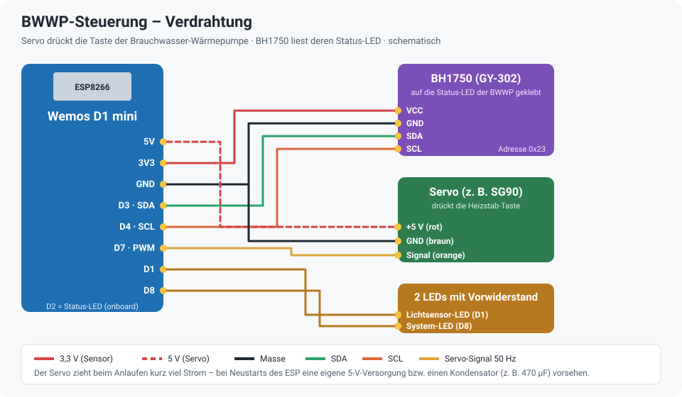
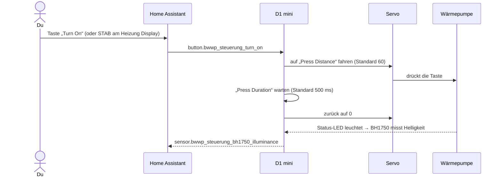

# BWWP-Steuerung – ESPHome

Macht eine **Brauchwasser-Wärmepumpe (BWWP)** ohne Smart-Home-Schnittstelle fernbedienbar – ganz ohne Eingriff ins Gerät:

- Ein **Servo** drückt auf Knopfdruck aus Home Assistant die Taste am Bedienfeld der Wärmepumpe (hier: Heizstab starten).
- Ein **Helligkeitssensor (BH1750)** sitzt auf der Status-LED der Wärmepumpe und meldet, ob sie leuchtet.

Das [Heizung Display](../Heizung%20Display) nutzt beides: Ein Tipp auf **STAB** startet den Heizstab über diesen Servo.



## Hardware

| Teil | Pin | Hinweis |
|---|---|---|
| **Wemos D1 mini** (ESP8266) | | Versorgung über Micro-USB mit einem 5-V-Netzteil |
| **Servo** (z. B. SG90) | D7 (PWM, 50 Hz) | 5 V und GND vom D1 mini; Arm so montieren, dass er die Taste drückt |
| **BH1750 (GY-302)** | D3 = SDA, D4 = SCL | eigener I²C-Bus `lux_bus`, Adresse `0x23`; lichtdicht über der Status-LED befestigen |
| LED „Lichtsensor“ | D1 | über Home Assistant schaltbar |
| LED „System“ | D8 | blinkt kurz alle 3 s, solange eingeschaltet |
| Status-LED | D2 | ESPHome-Status (blinkt bei Verbindungsproblemen) |

## Ablauf beim Tastendruck



## Installation

1. `bwwp-steuerung.yaml` in den ESPHome-Ordner kopieren.
2. Die Zeilen aus `secrets.yaml.example` in die eigene `secrets.yaml` übernehmen und eigene Werte eintragen.
3. Feste IP unter `wifi: manual_ip:` anpassen oder den Block entfernen.
4. Beim ersten Mal per USB flashen, danach per OTA.
5. In Home Assistant hinzufügen und dann **justieren**: Mit „Servo Position“ (−100 … 100) ausprobieren, bei welchem Wert der Arm die Taste sicher drückt. Diesen Wert als „Press Distance“ eintragen, „Press Duration“ so lang wählen, wie die Taste gehalten werden muss.

## Entitäten in Home Assistant

| Entität | Bedeutung |
|---|---|
| `button.bwwp_steuerung_turn_on` | Taste einmal drücken (Servo hin und zurück) |
| `number.bwwp_steuerung_press_distance` | wie weit der Servo fährt (0–200, Standard 60) |
| `number.bwwp_steuerung_press_duration` | wie lange gedrückt wird in ms (300–5000, Standard 500) |
| `number.bwwp_steuerung_servo_position` | Servo direkt stellen (−100 … 100) – zum Justieren |
| `sensor.bwwp_steuerung_bh1750_illuminance` | Helligkeit der Status-LED in lx |
| `switch.bwwp_steuerung_esp_lichtsensor_wp_status_led` | LED an D1 |
| `switch.bwwp_steuerung_esp_lichtsensor_wp_status_servo_led` | blinkende LED an D8 |
| `switch.bwwp_steuerung_bwwp_steuerung_restart` | ESP neu starten |

## Hinweise

- **Servo-Strom:** Beim Anlaufen zieht der Servo kurz viel Strom. Startet der ESP dabei neu, hilft ein Elko (z. B. 470 µF) an 5 V/GND oder eine eigene 5-V-Versorgung für den Servo.
- **Blinkende LED an D8:** Das Einschalten startet eine Endlosschleife. Ausschalten macht die LED nur kurz aus; die Schleife läuft weiter, bis der ESP neu startet. Wer das ändern will, ersetzt die Schleife durch ein `script` mit `script.stop` beim Ausschalten.
- Wie hell die Status-LED auf dem Sensor ankommt, hängt von der Montage ab – einen passenden Schwellwert in Home Assistant am besten mit dem **Schwellenwert-Helfer** auf `sensor.bwwp_steuerung_bh1750_illuminance` festlegen.

## Dateien

```
bwwp-steuerung.yaml    ESPHome-Konfiguration
secrets.yaml.example   Vorlage für secrets.yaml (nicht ins Repo!)
docs/                  Verdrahtung
.gitignore             hält secrets.yaml und den Build-Ordner aus dem Repo
```
