# Display Bad – ESPHome

Ein kleines Farbdisplay im Bad (früher „Test Lilygo 2“). Ein **LILYGO T-Display S3** zeigt im Ruhebild das **Wetter mit animiertem Icon**, die **Außentemperatur**, Luftfeuchte und Wind. Sobald eine **Oral-B-Zahnbürste** eingeschaltet wird, wechselt es auf einen **2-Minuten-Putzring** mit dem animierten Avatar der Person, die gerade putzt, und zeigt danach das Ergebnis.

Nebenbei arbeitet das Display als **Bluetooth-Proxy**: Es empfängt die Zahnbürsten im Bad und reicht sie an Home Assistant weiter. Ohne das Display waren die Bürsten dort nur sporadisch zu sehen.

<p align="center">
  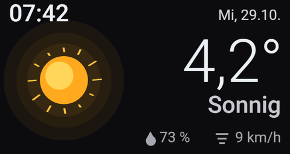
  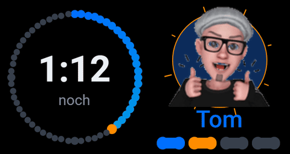
  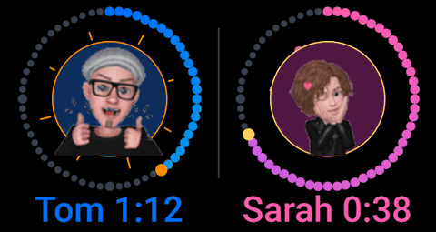
</p>

> Alle Bilder auf dieser Seite sind Vorschauen, die aus dem Zeichen-Code der YAML mit denselben Koordinaten, Farben und Formeln nachgezeichnet wurden – keine Fotos vom Gerät. Die Werte (Uhrzeit, Temperatur …) sind Beispielwerte.

## Inhalt

- [Hardware](#hardware)
- [Ruhebild: Wetter](#ruhebild-wetter)
- [Zähneputzen](#zähneputzen)
- [So erkennt das Display eine Putzrunde](#so-erkennt-das-display-eine-putzrunde)
- [Installation](#installation)
- [Zahnbürsten einbinden](#zahnbürsten-einbinden)
- [Eigene Avatare](#eigene-avatare)
- [Verwendete Home-Assistant-Entitäten](#verwendete-home-assistant-entitäten)
- [Technische Hinweise](#technische-hinweise)
- [Dateien](#dateien)

## Hardware

| Teil | Hinweis |
|---|---|
| **LILYGO T-Display S3** | ESP32-S3 mit 16 MB Flash und 8 MB Octal-PSRAM, Bluetooth LE 5.0, 1,9″-Farbdisplay 320 × 170 (ST7789, 8-Bit parallel), quer eingebaut |
| Tasten | GPIO0 und GPIO14 auf der Platine – erscheinen in Home Assistant als „Button 1“ und „Button 2“ |
| Hintergrundbeleuchtung | AW9364-Treiber an GPIO38 (16 Helligkeitsstufen) – in Home Assistant als dimmbares Licht „Backlight“ |

Es muss nichts verdrahtet werden – nur USB-C zur Stromversorgung.

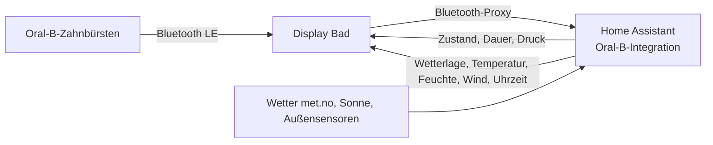

## Ruhebild: Wetter

Solange niemand putzt, zeigt das Display das Ruhebild. Es wird zehnmal pro Sekunde neu gezeichnet, damit das Wetter-Icon flüssig läuft.

| Bereich | Inhalt | Quelle |
|---|---|---|
| Oben links | Uhrzeit | Zeit von Home Assistant |
| Oben rechts | Wochentag und Datum, z. B. „Mi, 29.10.“ | Zeit von Home Assistant |
| Links | großes **animiertes Wetter-Icon** mit sanftem Leuchten in der Farbe des Wetters | `weather.forecast_home`, nachts `sun.sun` |
| Rechts groß | Außentemperatur mit Dezimalkomma (ab −10 °C ohne Nachkomma) | `sensor.mittelwert_temperatur_aussen` |
| Rechts darunter | Wetter in Worten | `weather.forecast_home` |
| Unten | Luftfeuchte (Tropfen) und Wind (Striche) | `sensor.mittelwert_huminity_aussen`, Attribut `wind_speed` der Vorhersage |
| Oben Mitte | roter Punkt „offline“, nur wenn die Verbindung zu Home Assistant fehlt | – |

Alle Icons werden auf dem ESP gezeichnet und bewegt – es werden dafür keine Bilddateien gebraucht.

<p align="center">
  
  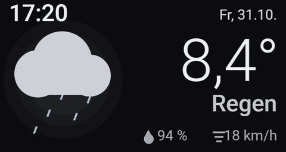
  
</p>
<p align="center">
  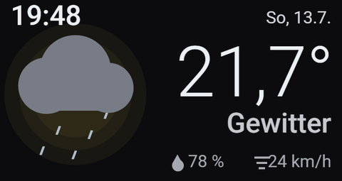
  
</p>

### Alle Wetterlagen

| | |
|---|---|
|  | 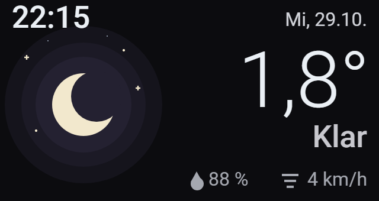 |
| **Sonnig** (`sunny`) – Sonne mit zwölf langsam kreisenden Strahlen, die leicht „atmen“; warmes oranges Leuchten | **Klar** (`clear-night`) – Mondsichel mit sechs funkelnden Sternen; lila Leuchten |
| 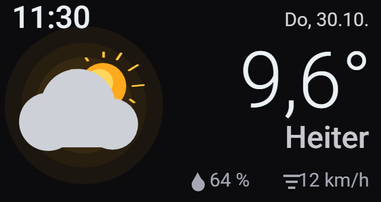 | 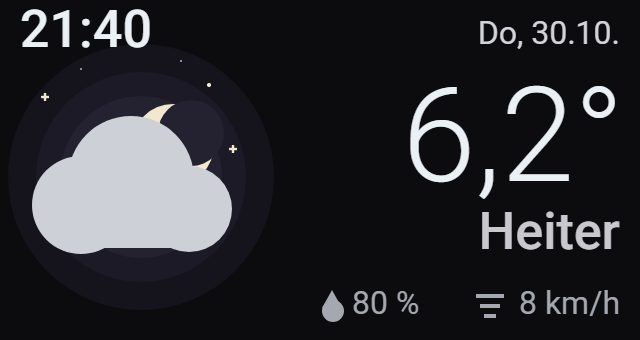 |
| **Heiter** (`partlycloudy`) – Sonne hinter einer Wolke, die langsam hin und her zieht | **Heiter in der Nacht** – wie heiter, aber mit Mond und Sternen (erkannt über `sun.sun`) |
| 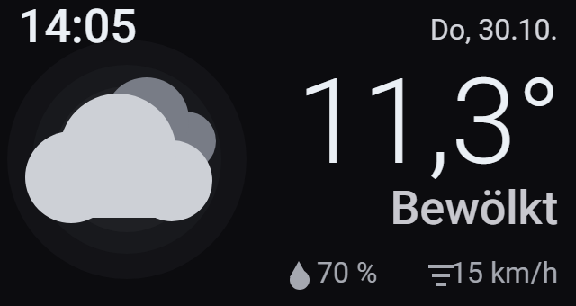 | 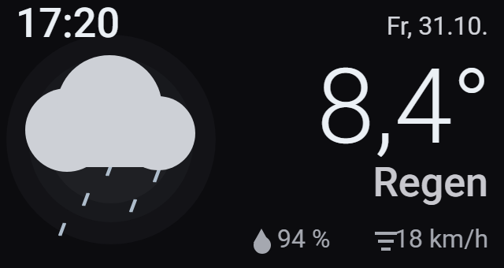 |
| **Bewölkt** (`cloudy`) – zwei Wolken, die gegeneinander ziehen | **Regen** (`rainy`) – fünf fallende Tropfen unter der Wolke |
| 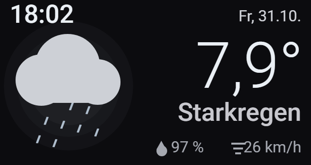 | 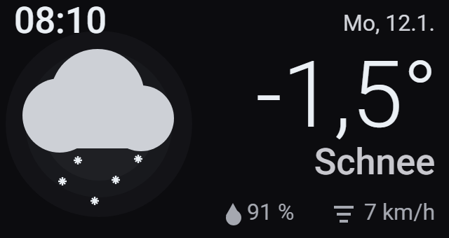 |
| **Starkregen** (`pouring`) – acht Tropfen, schneller | **Schnee** (`snowy`) – Schneeflocken, die beim Fallen hin und her schwingen |
| 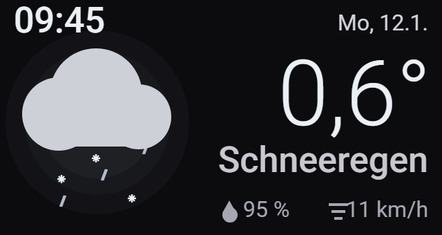 | 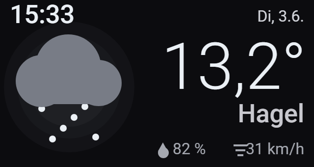 |
| **Schneeregen** (`snowy-rainy`) – Flocken und Tropfen gemischt | **Hagel** (`hail`) – schnelle Hagelkörner unter einer dunklen Wolke |
| 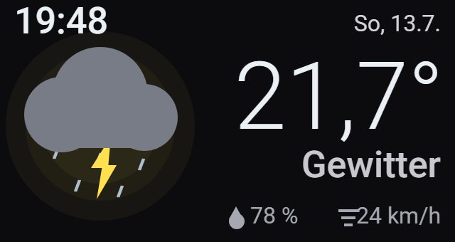 | 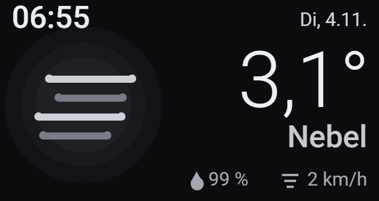 |
| **Gewitter** (`lightning`, `lightning-rainy`) – dunkle Wolke, alle 2,6 s zuckt ein gelber Blitz; gelbes Leuchten | **Nebel** (`fog`) – vier Nebelschwaden, die seitlich wabern |
| 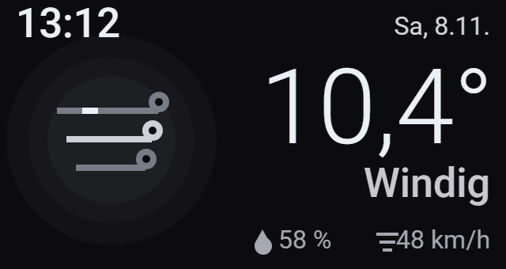 | |
| **Windig** (`windy`, `windy-variant`) – drei Windlinien mit wandernden Böen | Unbekannte Zustände (z. B. `exceptional` = „Unwetter“) zeigen eine Wolke |

## Zähneputzen

Wird eine Zahnbürste eingeschaltet, springt das Display sofort auf die Putzansicht. Jede Person hat ihr eigenes Farbthema und ihren Avatar:

| | Tom | Sarah |
|---|---|---|
| Ring-Verlauf | Blau → Petrol | Pink → Flieder |
| Akzent | Orange | Gold |
| Medaillon | dunkelblau, Avatar mit Daumen hoch, kreisende Funken | dunkellila, zwinkernder Avatar, schwebende Herzchen |
| Feier am Ende | Sterne | Herzchen-Konfetti |

### Eine Person putzt

<p align="center">
  
  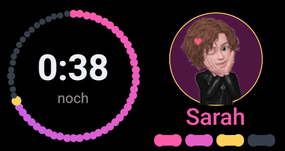
</p>

- **Links:** Ring aus 60 Punkten – jeder Punkt sind 2 Sekunden, der volle Ring sind die empfohlenen **2 Minuten**. Der erledigte Teil füllt sich mit dem Farbverlauf, der Kopf des Rings pulsiert in der Akzentfarbe, die vier dickeren grauen Punkte markieren die Viertel. In der Mitte läuft die **Restzeit** herunter.
- **Rechts:** Medaillon mit dem animierten Avatar, darunter der Name.
- **Unten rechts:** vier Kästchen für die vier Bereiche des Gebisses à 30 Sekunden – erledigte Bereiche werden farbig, der aktuelle blinkt.
- Die Bürste meldet ihre Dauer etwa alle 1–2 Sekunden. Dazwischen zählt das Display selbst weiter, damit der Ring flüssig läuft.

| | |
|---|---|
| 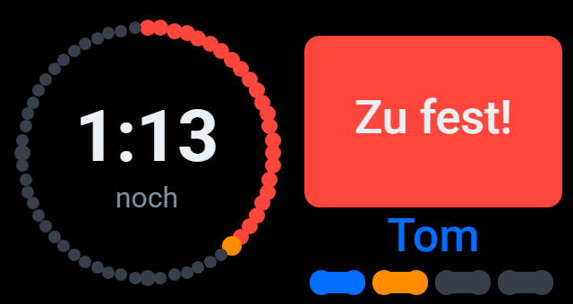 | 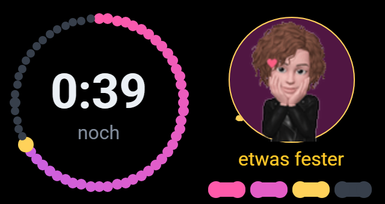 |
| **Zu viel Druck** – der Ring wird rot, statt des Avatars blinkt „Zu fest!“ | **Zu wenig Druck** (nur die iO meldet das) – unter dem Avatar blinkt „etwas fester“ |
| 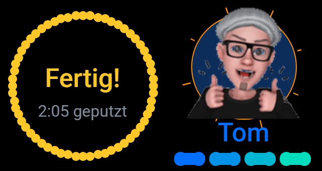 | |
| **2 Minuten erreicht** – der Ring wird gelb, in der Mitte „Fertig!“ und die bisher geputzte Zeit | |

### Beide putzen gleichzeitig

Laufen beide Bürsten, teilt sich das Display in zwei Hälften: außen jeweils der Zeitring, innen das Medaillon mit dem kleinen Avatar, darunter Name und Restzeit.

<p align="center"></p>

| | |
|---|---|
| 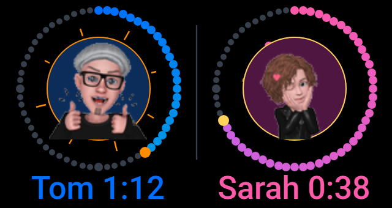 | 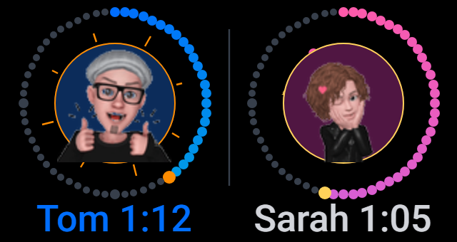 |
| **Beide laufen** – links Tom, rechts Sarah; bei zu viel Druck blinkt in der jeweiligen Hälfte „Zu fest!“, nach 2 Minuten steht dort „… fertig!“ | **Eine ist schon fertig** – hört eine Person auf, während die andere noch putzt, steht in ihrer Hälfte 8 s lang ihr Ergebnis; ab 1:50 „Super, …!“ in Gelb |

### Ergebnis

Nach dem Ausschalten zeigt das Display **8 Sekunden lang** das Ergebnis der Runde und kehrt dann zum Wetter zurück.

<p align="center"></p>

| | |
|---|---|
| 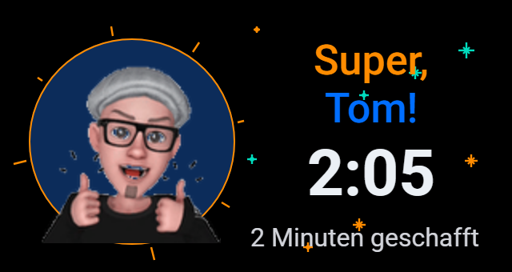 | 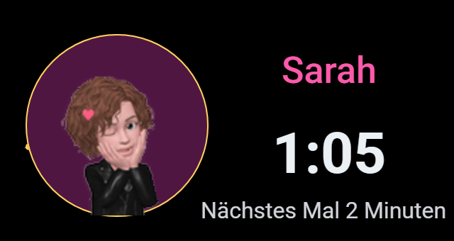 |
| **Ab 1:50** – „Super, Tom!“, die Zeit und „2 Minuten geschafft“, dazu funkelnde Sterne (bei Sarah Herzchen) | **Kürzer** – Name, Zeit und „Nächstes Mal 2 Minuten“ |

Ein Ergebnis gibt es ab 3 Sekunden Putzen. Kürzeres Ein- und Ausschalten springt gleich zurück zum Wetter.

## So erkennt das Display eine Putzrunde

Die Oral-B-Integration in Home Assistant liefert pro Bürste einen **Zustand** (`running`, `idle`, `off`, `selection_menu`, `initializing` …), die **Dauer** in Sekunden und den **Druck** (`normal`, `high`, bei der iO auch `low`). Allein daraus lässt sich eine Runde nicht sauber erkennen – zum Beispiel steht in der Dauer noch der Wert der letzten Runde, bis die Bürste den neuen schickt. Das Display verfolgt deshalb jede Runde selbst:

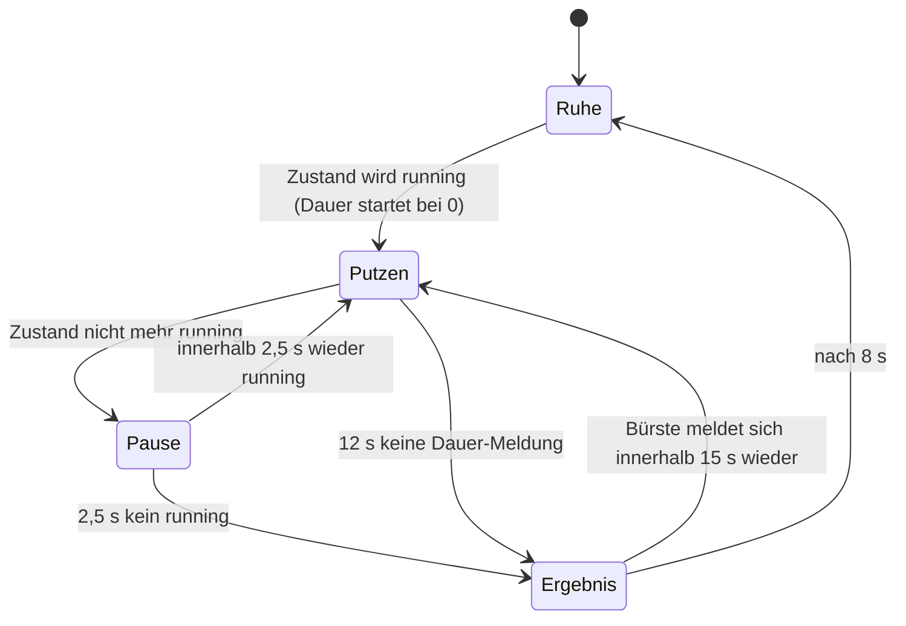

- **Start:** Mit `running` beginnt eine neue Runde bei 0 Sekunden. Nur Dauer-Werte, die *während* der Runde kommen, zählen – der Wert der letzten Runde wird ignoriert.
- **Kurze Pausen:** Die Bürsten melden zwischendurch kurz `idle` (z. B. beim Wechsel des Putzmodus). Erst wenn 2,5 Sekunden lang kein `running` mehr kommt, ist die Runde zu Ende.
- **Funklücke:** Kommt 12 Sekunden lang keine Dauer-Meldung, gilt die Runde als beendet, auch wenn Home Assistant noch `running` zeigt (Bürste außer Reichweite). Meldet sich die Bürste innerhalb von 15 Sekunden wieder, läuft dieselbe Runde weiter.
- **Zwei Bürsten:** Haben sich die Runden überlappt, bleibt die geteilte Ansicht stehen, bis beide fertig sind. Fängt jemand erst nach dem Ende der anderen Runde an, kommt sofort die eigene Einzelansicht. Das Ergebnisbild zeigt immer die zuletzt beendete Runde.

## Installation

1. `display-bad.yaml` sowie `image/tom.gif` und `image/sarah.gif` in den ESPHome-Ordner kopieren (die GIFs nach `image/`).
2. Die Zeilen aus `secrets.yaml.example` in die eigene `secrets.yaml` übernehmen und eigene Werte eintragen.
3. Feste IP unter `wifi: manual_ip:` anpassen oder den Block entfernen (dann DHCP).
4. Oben unter `substitutions:` die Zahnbürsten eintragen (siehe unten).
5. Beim ersten Mal per USB flashen, danach per OTA. Das Kompilieren dauert wegen der vier Avatar-Animationen etwas länger.
6. Nach dem Flashen **gut eine Minute laufen lassen**, bevor man das Gerät neu startet – erst dann gilt die neue Firmware als gültig. Ein früher Neustart kann sonst auf die alte Firmware zurückfallen. Ob die neue läuft, sieht man in Home Assistant an der Firmware-Version des Geräts.

## Zahnbürsten einbinden

1. Display flashen, dann die Zahnbürste in der Nähe einschalten.
2. Home Assistant meldet sie unter **Einstellungen → Geräte & Dienste** als neu gefunden (Integration **Oral-B**) – hinzufügen und dem Gerät einen Namen geben.
3. In `substitutions:` die **Haupt-Entität** der Bürste eintragen – die ohne Zusatz, deren Zustand `running`/`idle` ist. Das Display hängt selbst `_dauer` und `_druck` an.

```yaml
substitutions:
  buerste1_id: sensor.tom
  buerste1_name: Tom
  buerste2_id: sensor.badezimmer_sarah_iq
  buerste2_name: Sarah
```

| Eintrag | Bedeutung |
|---|---|
| `buerste1_id` / `buerste1_name` | Bürste 1 – Thema blau, Avatar `image/tom.gif` |
| `buerste2_id` / `buerste2_name` | Bürste 2 – Thema pink, Avatar `image/sarah.gif` |

Getestet mit Oral-B **Genius Series** (Tom) und Oral-B **iO** (Sarah). Die Entitätsnamen hängen davon ab, wie das Gerät in Home Assistant heißt – bei einer neuen Bürste also einfach die Zeile anpassen.

## Eigene Avatare

Die Avatare sind kleine Animationen mit transparentem Hintergrund (18 Bilder, 120 × 120). ESPHome spielt sie als `animation:` ab, groß (112 px) und klein (80 px für die geteilte Ansicht).

- **Tom:** aus einem WhatsApp-GIF. WhatsApp verschickt GIFs als kurzes MP4 mit weißem Hintergrund. Der Hintergrund wurde mit ffmpeg transparent gemacht:

  ```bash
  ffmpeg -i video.mp4 -vf "colorkey=0xFFFFFF:0.10:0.04,scale=120:120:flags=lanczos,split[a][b];[a]palettegen=reserve_transparent=1[p];[b][p]paletteuse=alpha_threshold=128" -gifflags -offsetting tom.gif
  ```

- **Sarah:** aus einer animierten WebP, die schon transparent war. Hier **ohne** `colorkey` umwandeln, sonst geht die Transparenz verloren:

  ```bash
  ffmpeg -i sarah.webp -vf "format=rgba,scale=120:120:flags=lanczos,split[a][b];[a]palettegen=reserve_transparent=1[p];[b][p]paletteuse=alpha_threshold=128" -gifflags -offsetting sarah.gif
  ```

## Verwendete Home-Assistant-Entitäten

| Anzeige | Entität |
|---|---|
| Außentemperatur | `sensor.mittelwert_temperatur_aussen` |
| Luftfeuchte außen | `sensor.mittelwert_huminity_aussen` |
| Wetterlage, Wind | `weather.forecast_home` (Zustand und Attribut `wind_speed`) |
| Tag/Nacht | `sun.sun` |
| Zahnbürsten | `${buerste_id}`, `${buerste_id}_dauer`, `${buerste_id}_druck` |

Das Display meldet an Home Assistant: Hintergrundbeleuchtung (dimmbar), die beiden Tasten und das WLAN-Signal.

## Technische Hinweise

- **Treiber:** Seit ESPHome 2026.10 baut die alte externe Komponente `landonr/lilygo-tdisplays3-esphome` nicht mehr. Das Display läuft mit dem nativen Treiber `mipi_spi` (Modell `T-DISPLAY-S3`) auf dem Framework **esp-idf** – das empfiehlt ESPHome auch für den Bluetooth-Proxy.
- **Bluetooth-Proxy:** `bluetooth_proxy` mit `active: true` und `esp32_ble_tracker`. WLAN und Bluetooth teilen sich die Antenne. Die Oral-B-Bürsten senden ihre Werte von sich aus, eine feste Verbindung ist nicht nötig.
- **Hintergrundbeleuchtung:** Der AW9364 wird mit Impulsen auf GPIO38 eingestellt. Nach dem Start wird er zurückgesetzt und neu eingestellt (`on_boot`), und das Licht ist nach jedem Start an (`RESTORE_AND_ON`) – sonst blieb es nach dem Flashen manchmal dunkel.
- **Schriften:** Roboto in vier Größen von Google Fonts. Die große Temperatur nutzt nur die nötigen Zeichen, damit der Flash-Speicher geschont wird.
- **Bildrate:** Das Display wird alle 100 ms neu gezeichnet.

## Dateien

```
display-bad.yaml       ESPHome-Konfiguration
image/tom.gif          Toms Avatar-Animation
image/sarah.gif        Sarahs Avatar-Animation
docs/                  Vorschaubilder und Animationen für diese Seite
secrets.yaml.example   Vorlage für secrets.yaml (nicht ins Repo!)
.gitignore             hält secrets.yaml und den Build-Ordner aus dem Repo
```
