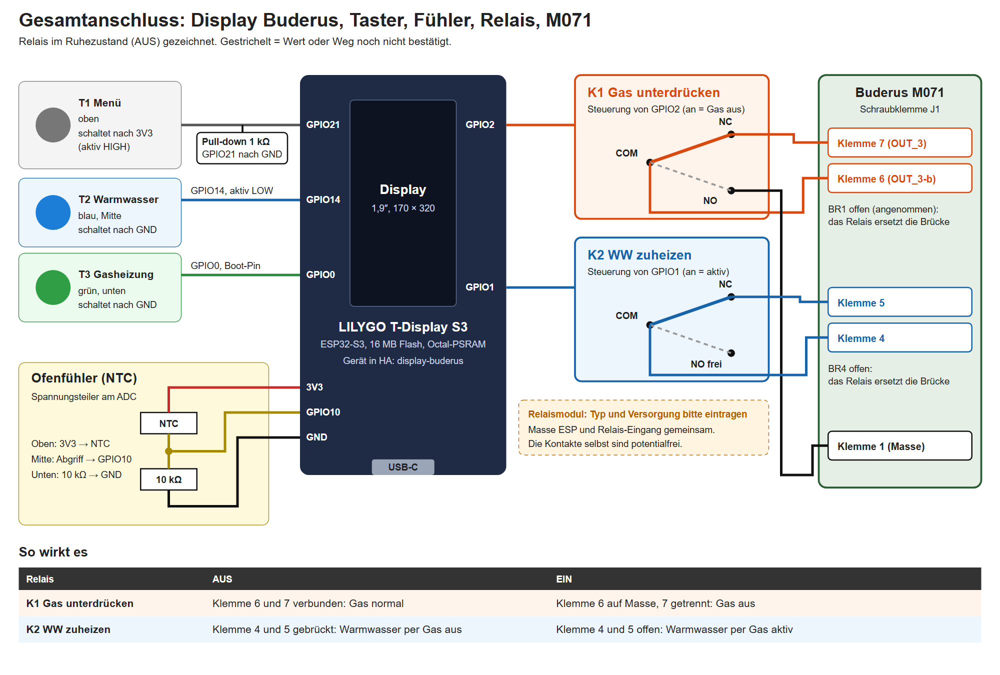
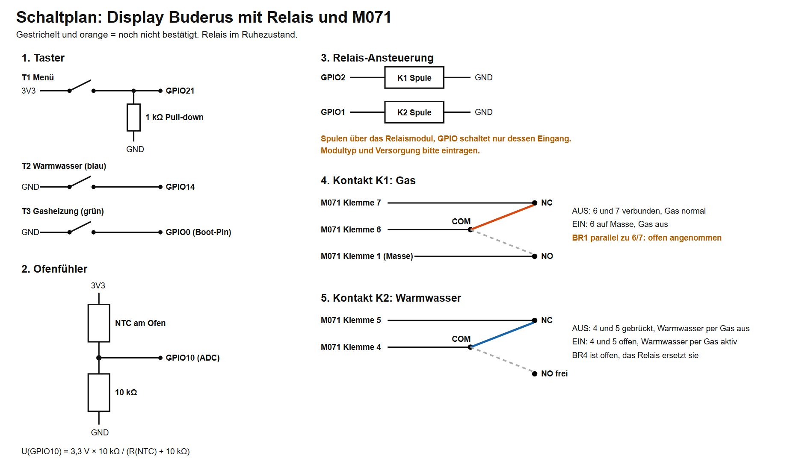
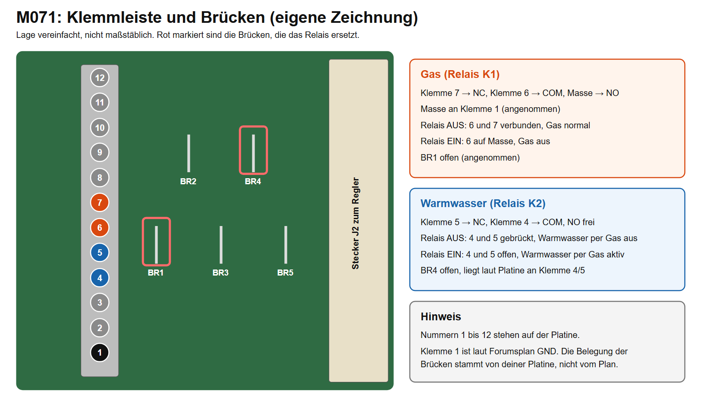

# Hardware Anschlussplan

Stand: 30.10.2026 · Gerät `display-buderus` · Regelung Buderus Ecomatic mit Schaltuhr-Modul M071

Dieses Dokument beschreibt die komplette Verdrahtung des Display Buderus: Display, Taster, Ofenfühler, Relais und den Anschluss am M071. Bedienung und Gas-Automatik sind in der Anleitung zum Display Buderus beschrieben.

> **Sicherheit:** Im Schaltkasten liegt Netzspannung an. Vor Arbeiten an der Verdrahtung die Anlage spannungslos schalten. Sicherheitsteile wie Sicherheitstemperaturbegrenzer und Feuerungsautomat dürfen nicht überbrückt werden.

## 1. Gesamtübersicht



Das Gerät besteht aus vier Teilen:

1. **LILYGO T-Display S3:** rechnet, zeigt an und steuert alles. Die Steuerung läuft auch ohne WLAN und Home Assistant weiter.
2. **Drei Taster:** Menü, Warmwasser und Gasheizung.
3. **Ofenfühler (NTC):** misst die Ofentemperatur für die Gas-Automatik.
4. **Zwei Relais:** greifen über das Modul M071 in die Regelung ein.

## 2. Bauteile

| Bauteil | Aufgabe | Details |
|---|---|---|
| LILYGO T-Display S3 | Steuerung und Anzeige | ESP32-S3, 16 MB Flash, Octal-PSRAM, Display 1,9″ mit 170 × 320 Pixeln |
| Taster T1 Menü | Seiten durchblättern | oben, schaltet nach 3V3 |
| Taster T2 Warmwasser | Seite Warmwasser, zweiter Druck schaltet | blau, Mitte, schaltet nach GND |
| Taster T3 Gasheizung | Seite Gasheizung, zweiter Druck schaltet | grün, unten, schaltet nach GND |
| Widerstand 1 kΩ | Pull-down an GPIO21 | hält den Eingang ohne Tastendruck auf LOW |
| Widerstand 10 kΩ | Spannungsteiler für den Ofenfühler | von GPIO10 nach GND |
| NTC-Fühler | Ofentemperatur | Abgleich siehe Kapitel 6 |
| Relais K1 | Gas unterdrücken | Wechselkontakt COM, NC, NO |
| Relais K2 | Warmwasser mit Gas zuheizen | Wechselkontakt COM, NC, NO |
| Buderus M071 | Schaltuhr-Modul in der Regelung | Schraubklemme J1 mit 12 Klemmen |

## 3. Belegung am ESP

| GPIO | Richtung | Funktion | Angeschlossen an |
|---|---|---|---|
| GPIO21 | Eingang, aktiv HIGH | Taster T1 Menü | Taster nach 3V3, 1 kΩ nach GND |
| GPIO14 | Eingang, aktiv LOW | Taster T2 Warmwasser | Taster nach GND |
| GPIO0 | Eingang, aktiv LOW | Taster T3 Gasheizung | Taster nach GND, **Boot-Pin** |
| GPIO10 | Analog | Ofenfühler | Mitte des Spannungsteilers |
| GPIO2 | Ausgang | Relais K1 Gas unterdrücken | Eingang Relaismodul |
| GPIO1 | Ausgang | Relais K2 WW zuheizen | Eingang Relaismodul |
| 3V3 | Versorgung | Taster T1, NTC | |
| GND | Masse | Taster T2 und T3, 10 kΩ, Relaismodul | |
| GPIO38 | Ausgang | Hintergrundbeleuchtung | intern auf der Platine |
| GPIO8, 39 bis 42, 45 bis 48 | Ausgang | Display-Datenbus | intern auf der Platine |

Wird T3 beim Einschalten gedrückt gehalten, startet der ESP im Flash-Modus statt normal.

## 4. Schaltplan



## 5. Taster

| Taster | Farbe und Lage | Pfeil auf dem Display | Erster Druck | Zweiter Druck auf derselben Seite |
|---|---|---|---|---|
| T1 Menü | oben | oben | weckt oder blättert | blättert weiter |
| T2 Warmwasser | blau, Mitte | Mitte, blauer Strich | zeigt Warmwasser und die Puffertemperatur | schaltet K2 |
| T3 Gasheizung | grün, unten | unten, grüner Strich | zeigt Gasheizung | schaltet K1 |

Die Eingänge sind in der Firmware entstört: 30 ms beim Drücken, 100 ms beim Loslassen und 400 ms Sperre nach jedem Tastendruck.

## 6. Ofenfühler

Der Fühler bildet mit dem 10-kΩ-Widerstand einen Spannungsteiler:

```
3V3 ──── NTC ────┬──── GPIO10
                 │
               10 kΩ
                 │
                GND
```

Spannung am Eingang: `U = 3,3 V × 10 kΩ / (R_NTC + 10 kΩ)`

**Aktueller Abgleich in Home Assistant:**

| Wert | Einstellung |
|---|---|
| Ofen NTC R25 | 12,3 kΩ |
| Ofen NTC B-Wert | 4650 |
| Ofen Korrektur | 0 °C |

Grundlage waren zwei Vergleiche: rund 16 kΩ bei 20,1 °C und der Messanschlag bei 88 °C. Der Bereich dazwischen ist noch nicht verglichen.

**Grenzen der Messung:**

- **Oben:** Bei rund 788 Ω ist der Messbereich zu Ende. Mit dem aktuellen Abgleich sind das etwa 89 °C. Bei heißerem Ofen bleibt die Anzeige dort stehen.
- **Unten:** Über 150 kΩ gilt der Fühler als gestört, die Automatik hebt dann ihre Sperre auf. Ein offener Fühlereingang misst etwa 230 bis 290 kΩ.

Für eine Messung über 89 °C wäre ein kleinerer Festwiderstand nötig, zum Beispiel 2,2 kΩ, und dazu eine Anpassung in der YAML. Das ist bisher nicht umgesetzt.

## 7. Relais

Beide Relais sind im Bild im Ruhezustand gezeichnet. Der Ruhekontakt NC ist also geschlossen, der Arbeitskontakt NO offen.

| Relais | Ansteuerung | COM | NC | NO |
|---|---|---|---|---|
| K1 Gas unterdrücken | GPIO2 | Klemme 6 | Klemme 7 | Klemme 1 (Masse) |
| K2 WW zuheizen | GPIO1 | Klemme 4 | Klemme 5 | frei |

| Relais | Relais AUS | Relais EIN |
|---|---|---|
| K1 Gas unterdrücken | 6 und 7 verbunden, Gas normal | 6 auf Masse, 7 getrennt, Gas aus |
| K2 WW zuheizen | 4 und 5 gebrückt, Warmwasser per Gas aus | 4 und 5 offen, Warmwasser per Gas aktiv |

## 8. Anschluss am M071




| Klemme | Funktion | Verbunden mit |
|---|---|---|
| 1 | Masse (GND) | K1 NO |
| 4 | Warmwasser per Gas | K2 COM |
| 5 | Warmwasser per Gas | K2 NC |
| 6 | Gas, Seite zum Regler | K1 COM |
| 7 | Gas, Seite zum Treiber | K1 NC |

- **BR4** liegt zwischen den Klemmen 4 und 5 und ist offen. Das Relais K2 übernimmt ihre Aufgabe.
- **BR1** liegt zwischen den Klemmen 6 und 7. Für diese Schaltung muss sie offen sein, das Relais K1 übernimmt ihre Aufgabe.

Die Belegung von BR4 und die Funktionen der Klemmen 4 bis 7 stammen aus Versuchen an der eigenen Anlage. Der im Heizungsforum veröffentlichte Plan zeigt an den Klemmen 4 und 5 BR5 und ist deshalb nur als grobe Orientierung zu verstehen.

## 9. Ablauf beim Schalten

**Warmwasser einschalten:**

1. Das Gerät merkt sich, ob Gas gerade gesperrt ist.
2. K1 geht aus, Gas ist frei.
3. Eine Sekunde später geht K2 an.
4. Solange Warmwasser läuft, sperrt die Gas-Automatik nicht.

**Warmwasser ausschalten**, von Hand oder wenn der Puffer `sensor.shellyplus_temperatur_bwwp_puffer_temperature` den Wert „WW zuheizen bis“ erreicht (aktuell 55 °C):

1. K2 geht aus.
2. War Gas vorher gesperrt, geht K1 wieder an.
3. Danach entscheidet wieder die Gas-Automatik nach der Ofentemperatur.

## 10. Prüfen nach dem Anschluss

Zum Messen das Messgerät auf Gleichspannung stellen, schwarz an Klemme 1.

| Schritt | Vorgehen | Erwartung |
|---|---|---|
| 1 | K1 aus, Klemme 6 und 7 auf Durchgang prüfen (Anlage spannungslos) | Durchgang |
| 2 | K1 ein, Spannung an Klemme 6 messen | etwa 0 V, Gas aus |
| 3 | K2 aus, Klemme 4 und 5 auf Durchgang prüfen (Anlage spannungslos) | Durchgang |
| 4 | K2 ein, Warmwasser per Gas anfordern | Warmwasser per Gas startet |
| 5 | In Home Assistant „Ofen NTC Widerstand“ ansehen | ruhiger Wert, bei 20 °C rund 16 kΩ |
| 6 | Jeden Taster drücken | passende Seite erscheint, Pfeil zeigt auf den Taster |

## 11. Fehlersuche

| Problem | Mögliche Ursache | Was tun |
|---|---|---|
| Gerät startet nicht normal | T3 beim Einschalten gedrückt | Taster loslassen, neu starten |
| Taster reagiert nicht | Pull-down, Leitung oder Taster | Spannung am GPIO beim Drücken messen |
| Relais schaltet zurück | Warmwasser fertig oder Gas-Automatik greift | Puffertemperatur und Einstellungen prüfen |
| Gas geht bei K1 nicht aus | BR1 noch drin, Masse fehlt oder Notbetrieb auf Hand | Klemme 6 messen und Notbetriebsschalter prüfen |
| Warmwasser per Gas geht nie an | BR4 noch drin | Durchgang 4 und 5 bei K2 EIN prüfen |
| Fühler zeigt etwa −30 °C oder „unbekannt“ | Fühler offen oder Wackelkontakt | Klemmen und Kabel prüfen |
| Fühler bleibt bei etwa 89 °C | Ende des Messbereichs | siehe Kapitel 6 |
| Neustarts | Stromversorgung oder Firmware | „Neustart Grund“ in Home Assistant ansehen |

## 12. Noch offen

Diese Angaben sind nicht bestätigt und hier nach dem Einbau zu ergänzen:

- [ ] Relaismodul: Typ und Versorgungsspannung: ____________
- [ ] Stromversorgung des ESP: ____________
- [ ] Masse für K1 NO wirklich an Klemme 1: ____________
- [ ] BR1 wirklich offen: ____________
- [ ] Abgleich des Fühlers bei etwa 55 °C geprüft: ____________
