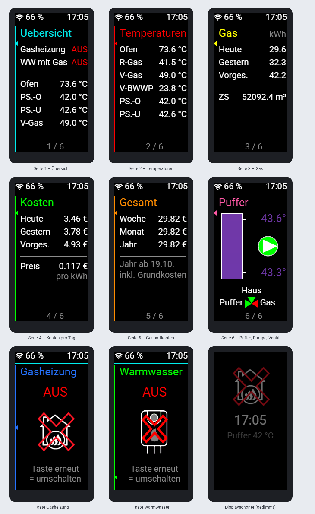
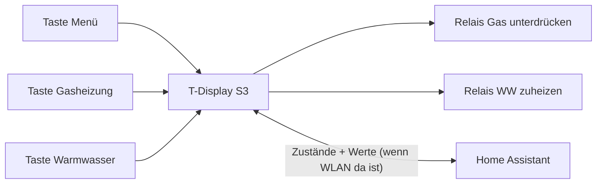

# Display Buderus – ESPHome

Bedien- und Anzeigedisplay neben der Buderus-Gasheizung: Ein **LILYGO T-Display S3** schaltet über zwei Relais die **Gasheizung** (sperren/freigeben) und das **Zuheizen des Warmwassers mit Gas**, und zeigt Temperaturen, Gasverbrauch, Gaskosten und den Pufferspeicher.

Die ganze Steuerung läuft **auf dem ESP selbst**. Fällt WLAN oder Home Assistant aus, funktionieren die Tasten und Relais weiter, und das Gerät startet deswegen nicht neu. Jede Änderung geht an Home Assistant, sobald die Verbindung wieder steht.



> Die Bilder sind Vorschauen, die aus dem Zeichen-Code der YAML mit echten Werten nachgebaut sind – keine Fotos vom Gerät.

## Hardware

| Teil | Hinweis |
|---|---|
| **LILYGO T-Display S3** | ESP32-S3 mit 16 MB Flash und Octal-PSRAM, 1,9″-Farbdisplay 170 × 320 (ST7789, 8-Bit parallel), hochkant |
| Relais „WW zuheizen“ | GPIO1 |
| Relais „Gas unterdruecken“ | GPIO2 |
| Taste 1 – Menü | GPIO21 (externe Taste, links oben neben dem Display) |
| Taste 2 – Gasheizung | GPIO14 (links in der Mitte) |
| Taste 3 – Warmwasser | GPIO0 (links unten) – Boot-Pin: beim Einschalten gedrückt halten = Flash-Modus |
| Hintergrundbeleuchtung | GPIO38 per PWM |

## Bedienung

| Taste | Erster Druck | Zweiter Druck auf derselben Seite |
|---|---|---|
| **Menü** | weckt das Display bzw. blättert: Übersicht → Temperaturen → Gas → Kosten → Gesamt → Puffer | – |
| **Gasheizung** | zeigt die Seite „Gasheizung“ (EIN/AUS) | schaltet das Relais „Gas unterdruecken“ um |
| **Warmwasser** | zeigt die Seite „Warmwasser“ (EIN/AUS) | schaltet das Relais „WW zuheizen“ um |

- Am linken Rand zeigt ein dünner Balken mit Pfeil in der Farbe der Überschrift, **welche Taste** zur Seite gehört.
- Von den beiden Schaltseiten springt das Display nach **15 s** zurück zur Übersicht.
- **Displayschoner:** Nach einer einstellbaren Zeit (Standard 120 s) wird das Display gedimmt und zeigt nur Brenner-Symbol, Uhrzeit und Puffertemperatur; das Bild wandert jede Minute ein Stück. Im Schoner weckt der erste Tastendruck nur auf und schaltet nichts.
- Die Relais behalten ihren Zustand auch nach Stromausfall oder Neustart.



## Die Seiten

| Seite | Inhalt |
|---|---|
| 1 Übersicht | Gasheizung EIN/AUS, Warmwasser mit Gas EIN/AUS, Ofen, Puffer oben/unten, Vorlauf Gas |
| 2 Temperaturen | Ofen, Rücklauf Gas, Vorlauf Gas, Vorlauf BWWP, Puffer oben/unten |
| 3 Gas | Verbrauch heute/gestern/vorgestern in kWh, darunter der Zählerstand in m³ |
| 4 Kosten | Kosten heute/gestern/vorgestern = kWh × Gaspreis (rechnet der ESP), darunter der Gaspreis |
| 5 Gesamt | Kosten Woche/Monat/Jahr inkl. Grundkosten (rechnet Home Assistant, siehe unten) |
| 6 Puffer | Tank mit Farbverlauf nach echter Temperatur oben/unten (blau ≤ 30 °C, rot ≥ 70 °C), Pumpe Puffer → Haus (grün = an, rot = aus), 3-Wege-Ventil Puffer/Haus/Gas |
| Gasheizung | groß EIN/AUS mit Brenner-Bild – über Taste 2 |
| Warmwasser | groß EIN/AUS mit BWWP-Bild – über Taste 3 |

Beim 3-Wege-Ventil gilt: Gas-Pumpe **aus** = Haus wird aus dem **Puffer** versorgt (Puffer + Haus grün, Gas rot); Gas-Pumpe **an** = Haus aus **Gas** (Gas + Haus grün, Puffer rot).

## In Home Assistant

### Vom Gerät

| Entität | Zweck |
|---|---|
| `switch.display_buderus_gas_unterdruecken` | Relais Gasheizung (lokal per Taste oder aus HA schaltbar) |
| `switch.display_buderus_ww_zuheizen` | Relais Warmwasser mit Gas |
| `light.…_backlight` | Hintergrundbeleuchtung |
| Displayschoner nach / Displayschoner Helligkeit | Einstellungen (0 s = Schoner aus; Helligkeit 1–60 %) |
| WiFi Signal dB | Diagnose |

### Vom Gerät gelesen

| Anzeige | Entität |
|---|---|
| Ofen, Rücklauf, Vorläufe, Puffer (Übersicht/Temperaturen) | `sensor.temperaturfuehler_puffer_*` |
| Puffer oben / unten (Seite Puffer) | `sensor.keller_shelly_mit_addon_heizung_fur_zirkulation_temperatur`, `…_temperatur_2` |
| 3-Wege-Ventil (aus = Puffer) | `binary_sensor.keller_shelly_mit_addon_heizung_fur_zirkulation_pumpe_gas_an_aus` |
| Pumpe Puffer → Haus | `switch.keller_shelly_mit_addon_heizung_fur_zirkulation` |
| Gas-Zählerstand, Verbrauch | `sensor.zahlerstand`, `sensor.verbrauch_energie_heute/_gestern/_vorgestern` (Tasmota-Gaszähler) |
| Gaspreis | `input_number.gasreis_eingabe` (EUR/kWh) |
| Kosten Woche / Monat / Jahr | `sensor.gas_kosten_woche`, `sensor.gas_kosten_monat`, `sensor.gas_kosten_seit_stichtag` |
| Stichtag | `input_datetime.gas_stichtag` |

### Gaskosten Woche / Monat / Jahr

Der Gaszähler liefert nur Tageswerte, deshalb zählt Home Assistant die Zeiträume selbst (alles als Helfer in der Oberfläche angelegt):

- **Verbrauchszähler** (`utility_meter`) auf `sensor.verbrauch_energie_heute`: `sensor.gas_energie_woche` (wöchentlich), `sensor.gas_energie_monat` (monatlich), `sensor.gas_energie_seit_stichtag` (ohne Rücksetzung).
- **Eingaben** im Dashboard: Gaspreis (`input_number.gasreis_eingabe`), **Grundkosten pro Monat** (`input_number.gas_grundkosten_monat`, 5–15 €) und **Stichtag** (`input_datetime.gas_stichtag`).
- **Kosten-Sensoren** (Template-Helfer): Verbrauch × Gaspreis + Grundkosten anteilig pro angefangenem Tag (Grundkosten × 12 / 365).
- **Vor dem Stichtag zählt nichts:** Liegt der Stichtag im laufenden Monat oder in der laufenden Woche, beginnen auch diese erst am Stichtag. Das „Jahr“ läuft vom Stichtag bis zum nächsten Jahrestag.
- **Automation „Gas Jahreszähler ab Stichtag“:** Wird der Stichtag geändert, holt sie den Verbrauch ab Stichtag aus der Langzeitstatistik (`recorder.get_statistics`, Tageswerte) und stellt die Zähler damit neu ein (`utility_meter.calibrate`); am Jahrestag setzt sie den Jahreszähler zurück.

## Installation

1. `display-buderus.yaml` und den Ordner `image/` in den ESPHome-Ordner kopieren.
2. Die Zeilen aus `secrets.yaml.example` in die eigene `secrets.yaml` übernehmen und eigene Werte eintragen.
3. Die Entitäten (siehe oben) an das eigene Home Assistant anpassen.
4. Beim ersten Mal per USB flashen, danach per OTA.

## Hinweise

- **ESPHome 2026.10:** Das Display läuft mit dem eingebauten Treiber `mipi_spi` (Modell `T-DISPLAY-S3`) und dem Framework **ESP-IDF**. Die frühere externe Komponente `landonr/lilygo-tdisplays3-esphome` lässt sich mit aktuellen ESPHome-Versionen nicht mehr bauen.
- **Nach einem OTA-Update mindestens eine Minute warten**, bevor man das Gerät neu startet: Erst dann gilt die neue Firmware als gut. Ein früher Neustart (oder ein Absturz) holt automatisch die alte Firmware zurück.
- **Schrift mit € und ³:** Gibt man bei einer Schrift `glyphs:` an, fällt der Standard-Zeichensatz weg – deshalb steht `glyphsets: [GF_Latin_Kernel]` mit dabei.
- **Anzeige Gasheizung:** `GAS_ANZEIGE_INVERTIERT` in der YAML legt fest, wie das Relais „Gas unterdruecken“ als EIN/AUS angezeigt wird. Die Steuerung selbst ändert das nicht.

## Dateien

```
display-buderus.yaml   ESPHome-Konfiguration
image/                 Bilder für die Display-Seiten
secrets.yaml.example   Vorlage für secrets.yaml (nicht ins Repo!)
docs/                  Vorschau der Display-Seiten
.gitignore             hält secrets.yaml und den Build-Ordner aus dem Repo
```
