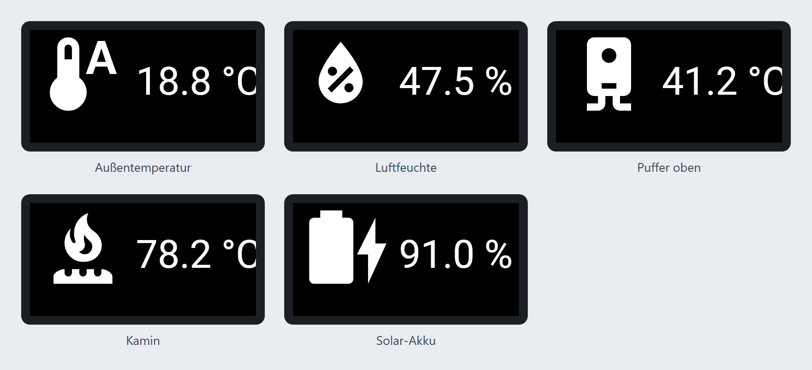
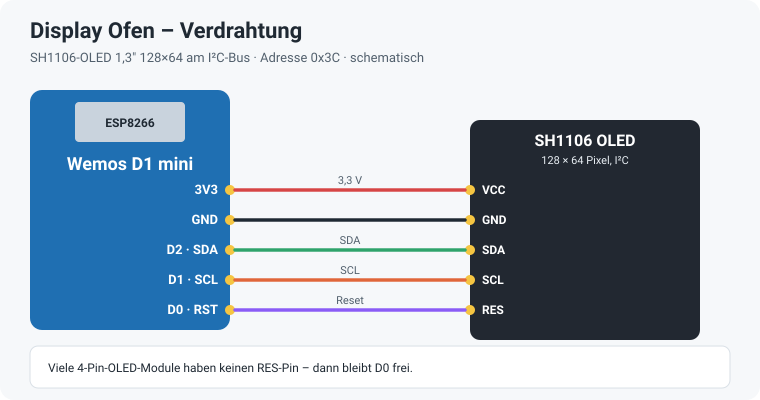
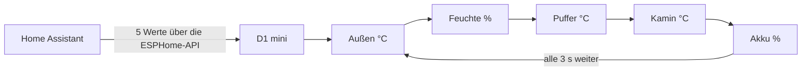

# Display Ofen – ESPHome

Kleines OLED-Display direkt am Holzofen: Ein **Wemos D1 mini** mit einem **1,3″-OLED (SH1106, 128 × 64)** zeigt im 3-Sekunden-Wechsel fünf Werte aus Home Assistant – jeweils mit passendem Symbol.



> Die Bilder sind Vorschauen, die aus den Koordinaten der YAML mit echten Werten nachgezeichnet sind – keine Fotos vom Gerät. Das „°C“ wird am rechten Rand angeschnitten – der Text beginnt in der YAML erst bei x = 60 auf dem 128 Pixel breiten Display.

## Seiten

| Seite | Symbol | Wert |
|---|---|---|
| 1 | Thermometer | Außentemperatur |
| 2 | Tropfen | Luftfeuchte außen |
| 3 | Boiler | Pufferspeicher oben |
| 4 | Brenner | Kamin-/Ofen-Vorlauf |
| 5 | Akku | Solar-Akku (SOC) – bis 50 % halbvolles, darüber volles Akku-Symbol |

## Hardware

| Teil | Hinweis |
|---|---|
| **Wemos D1 mini** (ESP8266) | Versorgung über Micro-USB mit einem 5-V-Netzteil |
| **OLED 1,3″ SH1106** | 128 × 64 Pixel, I²C-Adresse `0x3C`; um 180° gedreht eingebaut (`rotation: 180°`) |



| D1 mini | OLED |
|---|---|
| 3V3 | VCC |
| GND | GND |
| D2 | SDA |
| D1 | SCL |
| D0 | RES (falls vorhanden) |

## So läuft es



## Installation

1. `display-ofen.yaml` in den ESPHome-Ordner kopieren. Die Symbole kommen direkt aus den Material Design Icons (`mdi:`), es werden keine Bilddateien gebraucht.
2. Die Zeilen aus `secrets.yaml.example` in die eigene `secrets.yaml` übernehmen und eigene Werte eintragen.
3. Feste IP unter `wifi: manual_ip:` anpassen oder den Block entfernen.
4. Die Entitäten (siehe unten) an das eigene Home Assistant anpassen.
5. Beim ersten Mal per USB flashen, danach per OTA.

## Verwendete Home-Assistant-Entitäten

| Anzeige | Entität |
|---|---|
| Außentemperatur | `sensor.mittelwert_temperatur_aussen` |
| Luftfeuchte | `sensor.mittelwert_huminity_aussen` |
| Puffer oben | `sensor.temperaturfuehler_puffer_oben_temperatur_ch1` |
| Kamin | `sensor.temperaturfuehler_puffer_2_temperaturfuehler_puffer_ofen2_temperatur_ch1` |
| Solar-Akku | `sensor.victron_battery_soc` |
| (eingelesen, derzeit nicht angezeigt) | `switch.warmepumpe_sensor`, `switch.shelly_gas_brauchwasser_switch_0`, `switch.shelly_waermepumpen_grid_switch_0` |

Zusätzlich stellt das Gerät einen Schalter „Display Ofen Restart“ zum Neustarten bereit.

## Hinweise

- Die drei Schalter-Zustände (Wärmepumpe, Gas Brauchwasser, Wärmepumpen-Netz) werden schon eingelesen und können für eine weitere Seite genutzt werden.
- Das Display wird alle 3 Sekunden weitergeblättert und dabei neu gezeichnet.

## Dateien

```
display-ofen.yaml      ESPHome-Konfiguration
secrets.yaml.example   Vorlage für secrets.yaml (nicht ins Repo!)
docs/                  Vorschau der Seiten und Verdrahtung
.gitignore             hält secrets.yaml und den Build-Ordner aus dem Repo
```
