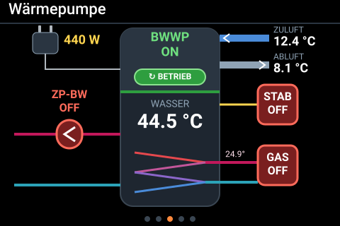
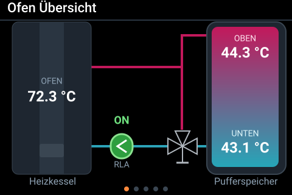
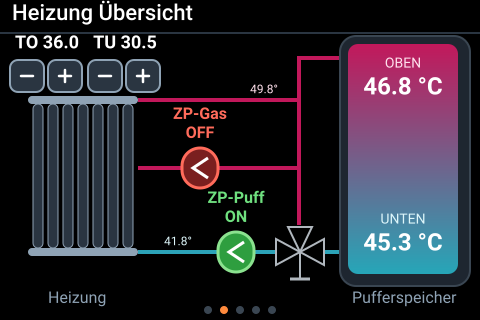
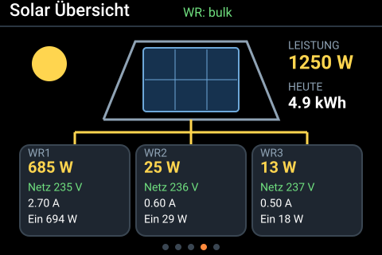
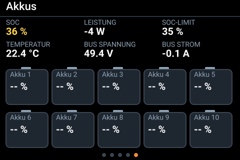

# Heizung Display – ESPHome / LVGL

Ein Touch-Display für die Wand, das die komplette Heizungs- und Solaranlage aus **Home Assistant** anzeigt: Holzofen mit Pufferspeicher, Heizkreis, Brauchwasser-Wärmepumpe (BWWP), Photovoltaik und Batteriespeicher. Gebaut mit [ESPHome](https://esphome.io) und [LVGL](https://esphome.io/components/lvgl/).



## Seiten

Blättern geht per Tipp auf die linke bzw. rechte Bildschirmhälfte, unten zeigen fünf Punkte die aktuelle Seite.

| Seite | Inhalt |
|---|---|
| 1 – Ofen | Heizkessel mit Vorlauftemperatur, Pufferspeicher oben/unten, Rücklaufanhebung (Pumpe wird grün ab 50 °C) |
| 2 – Heizung | Heizkörper, Pumpen ZP-Gas und ZP-Puff, Temperaturen an Vor- und Rücklauf, Grenzwerte TO/TU mit −/+ einstellbar |
| 3 – Wärmepumpe | BWWP ein/aus **und** ob sie wirklich läuft (60–900 W), Wassertemperatur, Leistung, Zu-/Abluft-Temperatur, Heizstab, Gas, Zirkulationspumpe |
| 4 – Solar | PV-Leistung, Tagesertrag, Wechselrichterzustand, MultiPlus L1–L3 |
| 5 – Akkus | SOC, Leistung, SOC-Limit, Temperatur, Busspannung und -strom |

| | |
|---|---|
|  |  |
|  |  |

> Die Bilder sind Vorschauen, die aus den Koordinaten der YAML nachgezeichnet sind (mit Beispielwerten) – keine Fotos vom echten Gerät.

### Bedienung am Display

- **Seite 2:** −/+ ändern `input_number.zirkulation_grenze_t1` (TO) und `…_t2` (TU).
- **Seite 3:** Tipp auf **ZP-BW** schaltet die Zirkulationspumpe, auf **GAS** das Gas-Relais für Brauchwasser, auf **STAB** startet den Heizstab.
- Nach 30 s ohne Berührung geht die Beleuchtung aus; die erste Berührung weckt das Display nur auf (ohne zu blättern).
- Jede Berührung gibt einen kurzen Klick-Ton über den Lautsprecher.

## Hardware

- Waveshare ESP32-S3 Touch-LCD 3,5″ (480 × 320)
  - Display **ST7796** über SPI (`mipi_spi`), Touch **FT6336** (I²C)
  - IO-Expander **PCA9554** (Display CS/Reset, Verstärker)
  - Audio-Codec **ES8311** mit Lautsprecher
- 16 MB Flash, Octal-PSRAM

Pinbelegung siehe `heizung-display.yaml` (I²C SDA GPIO8 / SCL GPIO7, SPI CLK GPIO5 / MOSI GPIO1 / MISO GPIO2, DC GPIO3, Backlight GPIO6).

> Beim Kompilieren meldet ESPHome, dass GPIO3 ein *Strapping-Pin* ist. Das ist nur ein Hinweis – so ist das Board verdrahtet, das Display läuft normal.

## Installation

1. Repository klonen oder `heizung-display.yaml` in den ESPHome-Ordner kopieren.
2. `secrets.yaml.example` in `secrets.yaml` umbenennen und WLAN-Daten sowie das Passwort für den Fallback-Hotspot eintragen.
3. In der YAML die Entitäten (siehe unten) an das eigene Home Assistant anpassen.
4. Im ESPHome-Dashboard **Install** wählen – beim ersten Mal per USB, danach per OTA.
5. Das Gerät in Home Assistant hinzufügen (Einstellungen → Geräte & Dienste → ESPHome) und unter den Geräteoptionen **„Darf Home-Assistant-Aktionen ausführen“** aktivieren, sonst funktionieren die Tasten auf dem Display nicht.

## Verwendete Home-Assistant-Entitäten

<details>
<summary>Liste aufklappen</summary>

**Ofen / Puffer**
- `sensor.temperaturfuehler_puffer_2_temperaturfuehler_puffer_ofen2_temperatur_ch1` – Ofen-Vorlauf
- `sensor.temperaturfuehler_puffer_oben_temperatur_ch1`, `sensor.temperaturfuehler_puffer_unten_temperatur_ch2` – Puffer oben/unten
- `sensor.keller_shelly_mit_addon_heizung_fur_zirkulation_temperatur`, `…_temperatur_2` – Puffer oben/unten (Seite 2)

**Heizung**
- `sensor.temperaturfuehler_puffer_3_temperaturfuehler_puffer_heizung_gas_vorlauf_3_temperatur_ch2` – Heizung-Gas-Vorlauf
- `sensor.temperaturfuehler_puffer_2_temperaturfuehler_puffer_ruecklauf2_temperatur_ch2` – Rücklauf
- `binary_sensor.keller_shelly_mit_addon_heizung_fur_zirkulation_pumpe_gas_an_aus` – ZP-Gas
- `switch.keller_shelly_mit_addon_heizung_fur_zirkulation` – ZP-Puff
- `input_number.zirkulation_grenze_t1`, `input_number.zirkulation_grenze_t2` – TO/TU

**Wärmepumpe**
- `switch.warmepumpe` – BWWP ein/aus
- `sensor.warmepumpe_leistung` – Leistung (läuft, wenn 60–900 W)
- `sensor.shellyplus_temperatur_bwwp_puffer_temperature` – Wassertemperatur
- `sensor.shellyplus_temperatur_bwwp_lufteinlass_temperature`, `…_luftauslass_temperature` – Zuluft/Abluft
- `sensor.temperaturfuehler_puffer_3_temperaturfuehler_puffer_bw_gas_vorlauf_3_temperatur_ch1` – BW-Gas-Vorlauf
- `switch.shellyplus_zirkulationspumpe` – ZP-BW
- `switch.relay_heizung_gas_bw_ch8` – Gas Brauchwasser
- `switch.bwwp_steuerung_esp_lichtsensor_wp_status_led`, `button.bwwp_steuerung_turn_on` – Heizstab

**Solar / Akkus (Victron, Pylontech)**
- `sensor.victron_system_dc_pv_power`, `sensor.gx_device_solar_erzeugung_taglich`
- `sensor.multiplus_ii_1_wechselrichterzustand`
- `sensor.multiplus_ii_1_wechselrichter_ausgangsleistung_l1…l3`, `…_eingangsleistung_l1…l3`, `…_ausgangsstrom_l1…l3`, `…_ausgangsspannung_l1…l3`
- `sensor.pylontech_battery_id_512_batterieladung`, `…_batterieleistung`, `…_batterietemperatur`, `…_dc_busspannung`, `…_dc_busstrom`
- `sensor.victron_settings_ess_batterylife_soclimit`

</details>

## Dateien

```
heizung-display.yaml   ESPHome-Konfiguration
secrets.yaml.example   Vorlage für secrets.yaml (nicht ins Repo!)
docs/                  Vorschaubilder der fünf Seiten
.gitignore             hält secrets.yaml und den Build-Ordner aus dem Repo
```

## Hinweise

- Die Akku-Kacheln 1–10 auf Seite 5 sind Platzhalter (`-- %`), bis Einzelwerte pro Modul verfügbar sind.
- Die Farben folgen einem festen Schema: rot = Vorlauf/aus, blau = Rücklauf, grün = an/läuft, grau = unbekannt.
