# Heizungs Display Übersicht Touch – ESPHome / LVGL

Touch-Display für den Heizungsraum: zeigt Ofen, Pufferspeicher, Warmwasser, Gas, Gaskosten, Solar und Akkus auf einen Blick. Puffer und Haus misst es mit **vier eigenen DS18B20-Fühlern**, diese Werte erscheinen also auch ohne WLAN und Home Assistant. Schalten und Einstellen geht direkt am Display, immer mit Rückfrage.

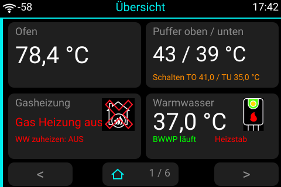

> Alle Bilder sind Vorschauen, die aus den Koordinaten der YAML mit Beispielwerten nachgezeichnet sind – keine Fotos vom Gerät.

## Inhalt

- [Menüstruktur](#menüstruktur)
- [Die Seiten](#die-seiten)
- [Bedienung](#bedienung)
- [Hardware und Schaltbild](#hardware-und-schaltbild)
- [Pumpe Kamin: Hysterese und Nachlauf](#pumpe-kamin-hysterese-und-nachlauf)
- [Installation](#installation)
- [Home-Assistant-Entitäten](#home-assistant-entitäten)
- [Dateien](#dateien)

## Menüstruktur

Sechs Hauptseiten werden mit `<` und `>` durchgeblättert. Die Mitte führt zurück zur Übersicht und zeigt die Seitenzahl (`2 / 6`). Drei Unterseiten erreicht man nur durch Antippen, sie haben nur `< Zurück`.

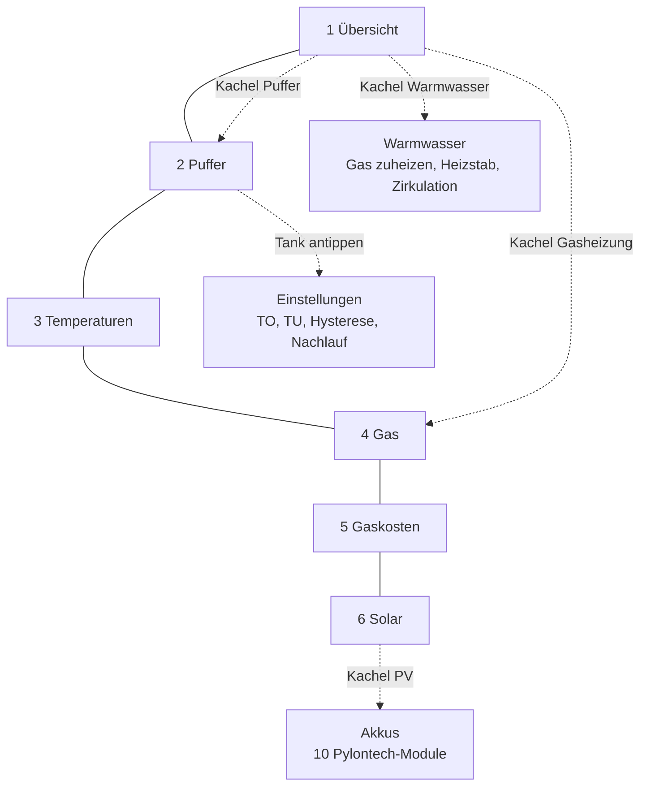

## Die Seiten

| | |
|---|---|
| **1 Übersicht** – Ofen, Puffer, Gasheizung, Warmwasser | **2 Puffer** – Tank mit Temperaturfarbe, Pumpen, Grenzwerte |
|  | 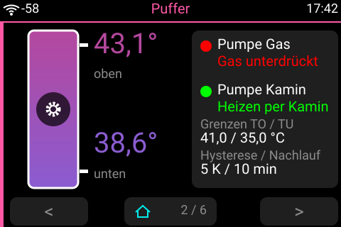 |
| **3 Temperaturen** – alle Fühler auf einen Blick | **4 Gas** – Verbrauch, Zählerstand, Gaspreis |
| 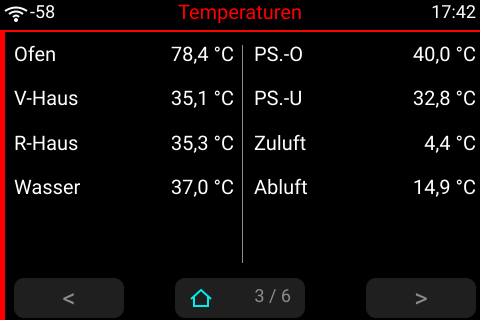 | 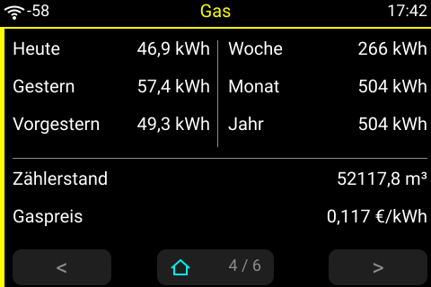 |
| **5 Gaskosten** – Tag, Woche, Monat, Jahr ab Stichtag | **6 Solar** – PV, Tagesertrag, Phasen L1–L3 |
| 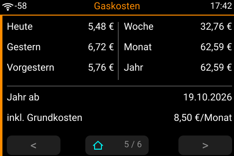 | 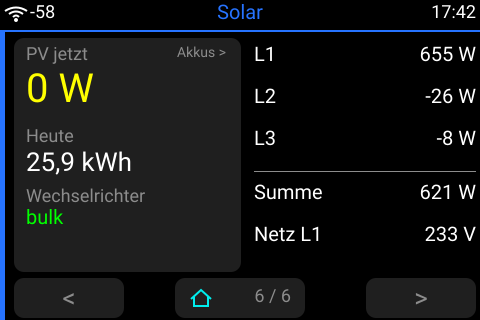 |
| **Warmwasser** (Unterseite) – Wärmepumpe und Schalter | **Einstellungen** (Unterseite) – Schaltwerte der Pumpe Kamin |
| 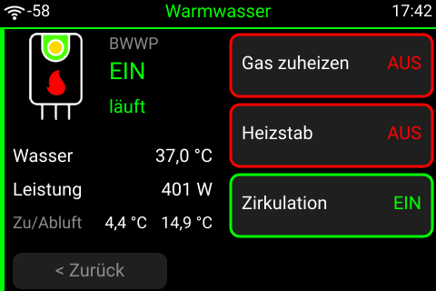 | 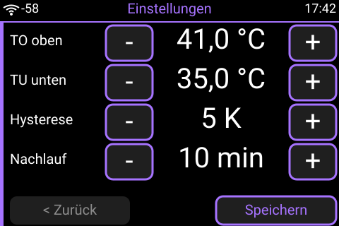 |
| **Akkus** (Unterseite) – Gesamtwerte und 10 Module | |
| 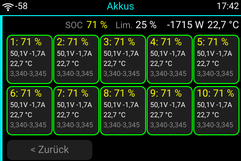 | |

**Farben:** grün = an/läuft, rot = aus, grau = kein Wert, orange = geändert, aber noch nicht gespeichert.

## Bedienung

- **Schalten:** Gas zuheizen, Heizstab und Zirkulation fragen erst nach, geschaltet wird nur mit **Ja**.
- **Einstellen:** `-` und `+` ändern die Werte zunächst nur am Display. **Speichern** fragt nach und schreibt dann alle vier Werte nach Home Assistant. Mit `< Zurück` verfallen nicht gespeicherte Änderungen.
- **Ruhezustand:** Nach 30 s ohne Berührung geht das Display zurück zur Übersicht und die Beleuchtung aus. Die erste Berührung weckt es nur, sie löst nichts aus.
- **Ton:** Jede Berührung gibt einen kurzen Klick über den Lautsprecher.
- **Taster 1 und 2:** Sie erscheinen als `binary_sensor` in Home Assistant und haben am Gerät noch keine eigene Funktion.

## Hardware und Schaltbild

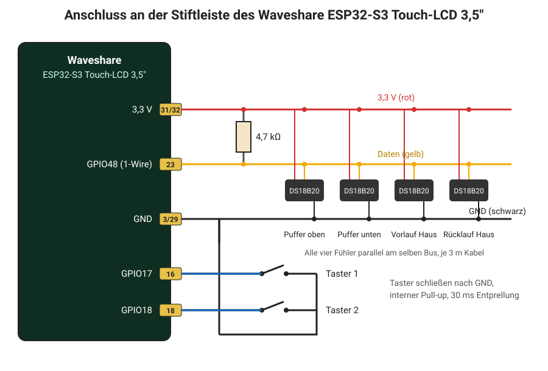

| Teil | Anschluss |
|---|---|
| **Waveshare ESP32-S3 Touch-LCD 3,5″** | 480 × 320, Display ST7796 (SPI), Touch FT6336 (I²C), 16 MB Flash, Octal-PSRAM, Codec ES8311, IO-Expander PCA9554 |
| 4 × DS18B20 mit 3 m Kabel | parallel: Daten an **GPIO48** (Leisten-Pin 23), 3,3 V an Pin 31/32, GND an Pin 3/29 |
| Widerstand 4,7 kΩ | zwischen Daten und 3,3 V (einmal für den ganzen Bus) |
| Taster 1 | **GPIO17** (Pin 16) nach GND, interner Pull-up, 30 ms Entprellung |
| Taster 2 | **GPIO18** (Pin 18) nach GND, interner Pull-up, 30 ms Entprellung |

**Fest auf dem Board:** I²C SDA GPIO8 / SCL GPIO7 (400 kHz), SPI CLK GPIO5 / MOSI GPIO1 / MISO GPIO2, DC GPIO3, Beleuchtung GPIO6, I²S LRCLK GPIO15 / BCLK GPIO13 / MCLK GPIO12 / DOUT GPIO16.

### Fühler zuordnen

Jeder DS18B20 hat eine eigene Adresse. Beim ersten Start mit `logger: level: DEBUG` stehen alle Adressen im Log. Zum Zuordnen einen Fühler in die Hand nehmen und schauen, welcher Wert steigt. Die Adressen in der YAML sind meine eigenen und müssen ersetzt werden.

| Fühler | Adresse in der YAML | Anzeige |
|---|---|---|
| Rücklauf Haus | `0x04000000d6775028` | R-Haus |
| Puffer unten | `0xb5000000d20a9828` | PS.-U |
| Puffer oben | `0xfb000000d4b44a28` | PS.-O |
| Vorlauf Haus | `0xad000000d6ae7628` | V-Haus |

## Pumpe Kamin: Hysterese und Nachlauf

Die Pumpe schaltet ein **Script auf dem Shelly Plus 1** mit Add-On ([`shelly/zirkulation.js`](shelly/zirkulation.js)). Es regelt auch weiter, wenn Home Assistant oder das Display ausfallen.

| Zustand | Bedingung |
|---|---|
| **Ein** | oben ≥ TO **und** unten ≥ TU |
| **Aus** | oben < TO − Hysterese **oder** unten < TU − Hysterese, und das die ganze Nachlaufzeit lang |
| **Sofort aus** | Eingang 100 am Add-On ist an (hat immer Vorrang) |

Beispiel mit TO 41 °C, TU 35 °C, Hysterese 5 K: Sie schaltet ein ab 41 / 35 °C und erst unter 36 / 30 °C wieder aus. Steigt die Temperatur vor Ablauf der Nachlaufzeit wieder darüber, beginnt die Zeit von vorn.

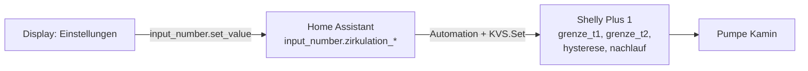

Dafür braucht Home Assistant diese Helfer, einen `rest_command` und eine Automation:

<details>
<summary>YAML für Home Assistant</summary>

```yaml
input_number:
  zirkulation_grenze_t1: {name: Zirkulation Grenze T1, min: 10, max: 90, step: 1, unit_of_measurement: "°C", mode: box}
  zirkulation_grenze_t2: {name: Zirkulation Grenze T2, min: 10, max: 90, step: 1, unit_of_measurement: "°C", mode: box}
  zirkulation_hysterese: {name: Zirkulation Hysterese, min: 1, max: 20, step: 1, unit_of_measurement: "K", mode: box}
  zirkulation_nachlauf: {name: Zirkulation Nachlauf, min: 0, max: 60, step: 1, unit_of_measurement: "min", mode: box}

rest_command:
  shelly_grenze_setzen:
    url: "http://IP-DES-SHELLY/rpc/KVS.Set"
    method: post
    content_type: "application/json"
    payload: '{"key": "{{ key }}", "value": {{ value | float }} }'

automation:
  - alias: Zirkulation Grenzwerte zum Shelly
    mode: queued
    triggers:
      - trigger: state
        entity_id:
          - input_number.zirkulation_grenze_t1
          - input_number.zirkulation_grenze_t2
          - input_number.zirkulation_hysterese
          - input_number.zirkulation_nachlauf
      - trigger: homeassistant
        event: start
    actions:
      - {action: rest_command.shelly_grenze_setzen, data: {key: grenze_t1, value: "{{ states('input_number.zirkulation_grenze_t1') }}"}}
      - {action: rest_command.shelly_grenze_setzen, data: {key: grenze_t2, value: "{{ states('input_number.zirkulation_grenze_t2') }}"}}
      - {action: rest_command.shelly_grenze_setzen, data: {key: hysterese, value: "{{ states('input_number.zirkulation_hysterese') }}"}}
      - {action: rest_command.shelly_grenze_setzen, data: {key: nachlauf, value: "{{ states('input_number.zirkulation_nachlauf') }}"}}
```

</details>

## Installation

1. `heizungs-display-uebersicht-touch.yaml` sowie die Ordner `heizungs-display/` und `image/` in den ESPHome-Ordner kopieren.
2. Die Zeilen aus `secrets.yaml.example` in die eigene `secrets.yaml` übernehmen.
3. In der YAML die Fühler-Adressen und die Entitäten an das eigene Home Assistant anpassen.
4. Im ESPHome-Dashboard **Install** wählen – beim ersten Mal per USB, danach per OTA.
5. Das Gerät in Home Assistant hinzufügen und unter den Geräteoptionen **„Darf Home-Assistant-Aktionen ausführen“** aktivieren, sonst funktionieren Schalter und Speichern nicht.
6. Für die Pumpe Kamin `shelly/zirkulation.js` als Script auf den Shelly laden, starten und auf „beim Start ausführen“ stellen.

> In der YAML haben API und OTA kein Passwort. Im eigenen Netz reicht das, sonst bitte Verschlüsselung und OTA-Passwort ergänzen.

## Home-Assistant-Entitäten

<details>
<summary>Liste aufklappen</summary>

**Vom Gerät**
- `sensor.heizungs_display_ubersicht_touch_puffer_oben`, `…_puffer_unten`, `…_vorlauf_haus`, `…_rucklauf_haus`
- `binary_sensor.heizungs_display_ubersicht_touch_taster_1`, `…_taster_2`
- `light.waveshare_display_test_display_hintergrundbeleuchtung`

**Puffer und Ofen**
- `sensor.aussen_display_buderus_ofen_fuehler` – Ofen (vom [Display Buderus](../Display%20Buderus))
- `sensor.keller_shelly_mit_addon_heizung_fur_zirkulation_temperatur`, `…_temperatur_2` – Puffer oben/unten am Shelly
- `binary_sensor.keller_shelly_mit_addon_heizung_fur_zirkulation_pumpe_gas_an_aus` – Pumpe Gas
- `switch.keller_shelly_mit_addon_heizung_fur_zirkulation` – Pumpe Kamin
- `input_number.zirkulation_grenze_t1`, `…_t2`, `…_hysterese`, `…_nachlauf`

**Warmwasser**
- `switch.warmepumpe`, `sensor.warmepumpe_leistung` (läuft bei 60–900 W)
- `sensor.shellyplus_temperatur_bwwp_puffer_temperature`, `…_lufteinlass_temperature`, `…_luftauslass_temperature`
- `switch.display_buderus_ww_zuheizen`, `switch.shellyplus_zirkulationspumpe`
- `button.bwwp_steuerung_turn_on`, `switch.bwwp_steuerung_esp_lichtsensor_wp_status_led` – Heizstab

**Gas**
- `switch.display_buderus_gas_unterdruecken`
- `sensor.zahlerstand`, `sensor.verbrauch_energie_heute`, `…_gestern`, `…_vorgestern`
- `sensor.gas_energie_woche`, `…_monat`, `…_seit_stichtag`, `sensor.gas_kosten_woche`, `…_monat`, `…_seit_stichtag`
- `input_number.gasreis_eingabe`, `input_number.gas_grundkosten_monat`, `input_datetime.gas_stichtag`

**Solar und Akkus (Victron, Pylontech)**
- `sensor.victron_system_dc_pv_power`, `sensor.gx_device_solar_erzeugung_taglich`, `sensor.multiplus_ii_1_wechselrichterzustand`
- `sensor.multiplus_ii_1_wechselrichter_ausgangsleistung_l1…l3`, `…_ausgangsspannung_l1`
- `sensor.pylontech_battery_id_512_batterieladung`, `…_batterieleistung`, `…_batterietemperatur`, `sensor.victron_settings_ess_batterylife_soclimit`
- `sensor.pylontech_batterie_system_2_battery1…10_*` – die Module (aus [Pylontech Batterie System 2](../Pylontech%20Batterie%20System%202))

</details>

## Dateien

```
heizungs-display-uebersicht-touch.yaml   ESPHome-Konfiguration
heizungs-display/helpers.h               Hilfsfunktionen für Anzeige und Farben
heizungs-display/akku-modul.yaml         ein Pylontech-Modul, 10-mal eingebunden
image/                                   Symbole (WLAN, Brenner, Wärmepumpe)
shelly/zirkulation.js                    Script für den Shelly der Pumpe Kamin
secrets.yaml.example                     Vorlage für die secrets.yaml
docs/                                    Vorschaubilder und Schaltbild
```

## Hinweise

- Beim Kompilieren meldet ESPHome, dass GPIO3 ein *Strapping-Pin* ist. Das ist nur ein Hinweis, so ist das Board verdrahtet.
- Anzeige und Touch laufen flüssig mit `logger: WARN`, 240 MHz, SPI 40 MHz und I²C 400 kHz. Schnell wechselnde Werte werden nur alle 5 bis 15 s neu gezeichnet.
