# Heizungs Display Übersicht Touch

Stand: 14.11.2026 · Firmware 2026.11.14 · Gerät `waveshare-display-test` · Einbauort Heizungsraum (ersetzt den LC2014)

Touch-Display für den Heizungsraum. Es zeigt Ofen, Pufferspeicher, Warmwasser, Gas, Gaskosten, Solar und Akkus und schaltet Warmwasser-Zuheizen, Heizstab und Zirkulation.

**Es regelt außerdem die Pumpe Kamin** (Pufferpumpe P2 mit 3-Wege-Ventil V1) direkt über ein SSR. Das übernahm früher ein Script auf einem Shelly Plus 1, der ausgebaut ist. Vier Shelly Decoupler melden, ob an den Pumpen und am Ventil wirklich Spannung anliegt.

Die fünf DS18B20-Fühler, die Regelung und die Schaltwerte arbeiten auch ohne WLAN und Home Assistant. Alle anderen Werte kommen aus Home Assistant und zeigen `--`, wenn dort keiner ankommt.

> Alle Display-Bilder sind Vorschauen, die aus den Koordinaten der Konfiguration nachgezeichnet sind. Es sind keine Fotos vom Gerät, und die Werte sind Beispiele.

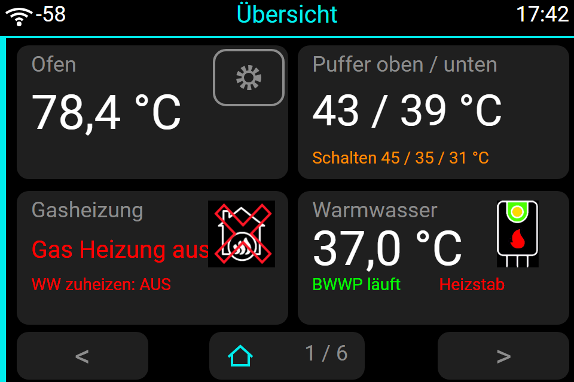

## 1. Auf einen Blick

| Punkt | Wert |
|---|---|
| Hardware | Waveshare ESP32-S3 Touch-LCD 3,5″, 480 × 320 |
| Konfiguration | `heizungs-display-uebersicht-touch.yaml` (im eigenen ESPHome-Ordner z. B. als `test-heizung.yaml`) |
| Hilfsdateien | `heizungs-display/helpers.h`, `heizungs-display/akku-modul.yaml`, `image/` |
| Anzeigename in Home Assistant | Heizungs Display Übersicht Touch |
| Fühler am Display | 5 × DS18B20: Puffer oben, mitte, unten, Vorlauf Haus, Rücklauf Haus |
| Ausgang | SSR für die Pumpe Kamin (GPIO38) |
| Eingänge | 4 × Shelly Decoupler 230V (GPIO39–42), 2 Taster (GPIO17/18, noch ohne Funktion) |
| Schaltwerte | zwei Profile **Tag** und **Abend**, Umschaltung nach Uhrzeit oder **Ganztags** |
| Beleuchtung | geht nach 1 Minute ohne Berührung aus |
| Firmware-Stand | auf der Admin-Seite 3 (Zahnrad auf der Übersicht) |

## 2. Menüstruktur

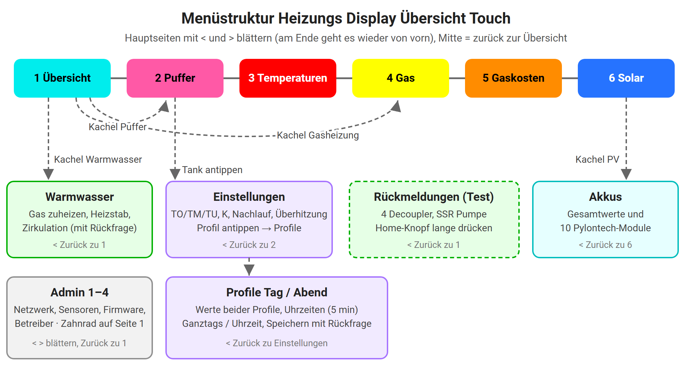

Die sechs Hauptseiten werden mit `<` und `>` durchgeblättert. Ein **kurzer** Tipp auf die Taste in der Mitte führt zur Übersicht, **lang gedrückt** öffnet sie die Testseite „Rückmeldungen“. Die Unterseiten haben eigene Knöpfe unten.

| Von | Antippen | Führt zu |
|---|---|---|
| Übersicht | Kachel Puffer | Seite 2 Puffer |
| Übersicht | Kachel Gasheizung | Seite 4 Gas |
| Übersicht | Kachel Warmwasser | Unterseite Warmwasser |
| Übersicht | **Zahnrad** oben rechts in der Kachel Ofen | Admin-Ansicht (4 Seiten) |
| Puffer | Tank oder Temperaturen | Unterseite Einstellungen |
| Einstellungen | Feld **Aktives Profil** | Unterseite Profile Tag / Abend |
| Solar | Kachel PV | Unterseite Akkus |
| jede Hauptseite | Home-Taste lange drücken | Testseite Rückmeldungen |

Keine Seite lässt sich verschieben (scrollen). Das verhindert, dass eine kleine Fingerbewegung als Wischen statt als Tipp zählt.

## 3. Die Seiten

### Seite 1: Übersicht

Ofen, Puffer oben und unten mit den Einschaltwerten (oben / mitte / unten), Gasheizung und Warmwasser. Bei der Gasheizung heißt „Heizen per Gas“, dass die Pumpe Gas läuft, „Gas Heizung aus“, dass sie steht. Beides kommt von der Rückmeldung des Decouplers an der Pumpe Gas. Das **Zahnrad** öffnet die Admin-Ansicht.

### Seite 2: Puffer

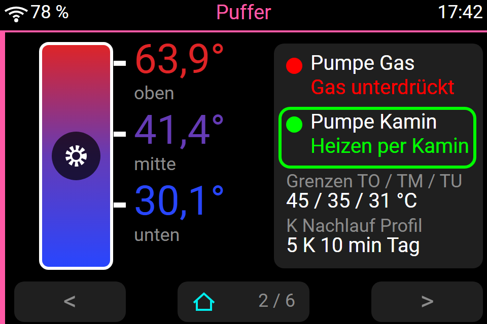

| Anzeige | Bedeutung |
|---|---|
| Tank | Farbverlauf nach den echten Temperaturen oben, mitte und unten: bis 30 °C blau, ab 70 °C rot |
| oben / mitte / unten | die drei DS18B20 im Puffer, die Striche am Tank zeigen auf den Wert |
| Pumpe Gas | „Heizen per Gas“ oder „Gas unterdrückt“, aus der Rückmeldung Decoupler 2 |
| Knopf **Pumpe Kamin** | Rahmen grün = an, rot = aus. Text „Heizen per Kamin“ oder „aus“, im Handbetrieb „Hand: EIN / Hand: AUS“. Antippen schaltet von Hand, mit Nachfrage (siehe 4.3) |
| Grenzen TO / TM / TU | Einschaltwerte des aktiven Profils |
| K  Nachlauf  Profil | Hysterese, Nachlaufzeit und aktives Profil (Tag oder Abend) |

Antippen von Tank oder Temperaturen öffnet die Einstellungen.

### Seite 3: Temperaturen

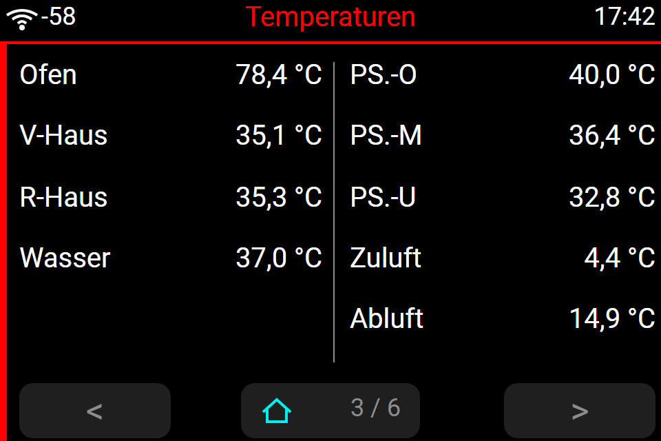

| Anzeige | Quelle |
|---|---|
| Ofen | Fühler am Display Buderus |
| V-Haus, R-Haus | DS18B20 am Display |
| PS.-O, PS.-M, PS.-U | DS18B20 am Display (Puffer oben, mitte, unten) |
| Wasser, Zuluft, Abluft | Shelly an der BWWP |

### Seite 4: Gas

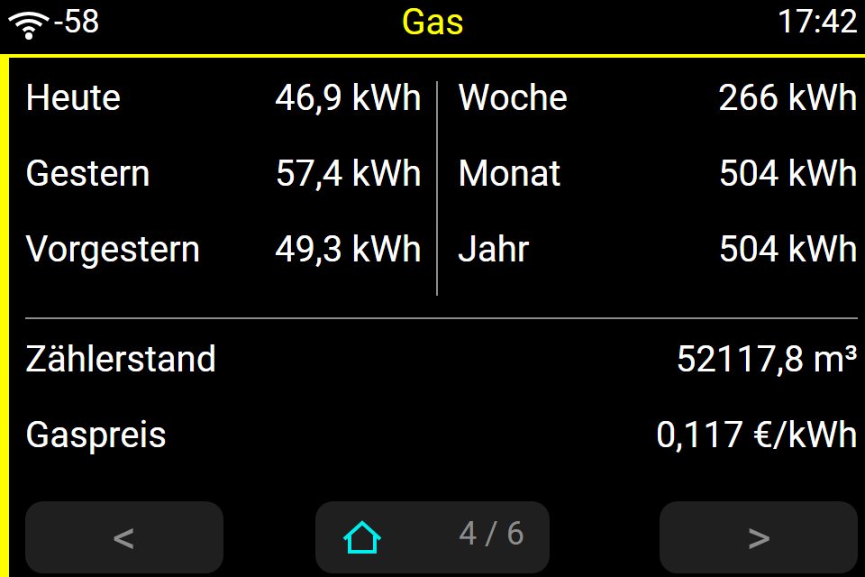

Verbrauch heute, gestern und vorgestern, dazu Woche, Monat und Jahr ab Stichtag. Darunter Zählerstand und Gaspreis.

### Seite 5: Gaskosten

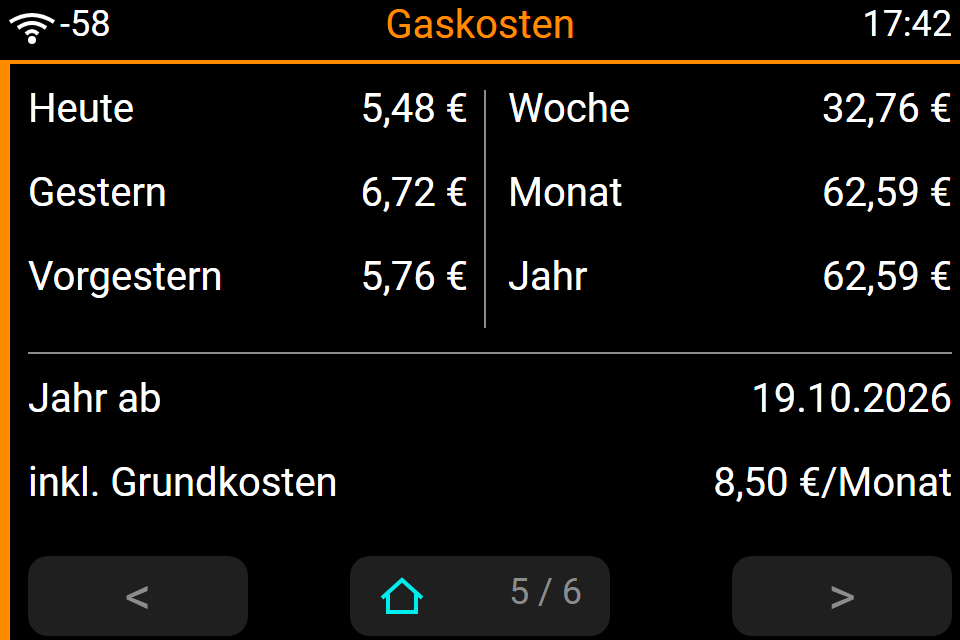

Tageskosten rechnet das Display aus kWh × Gaspreis. Woche, Monat und Jahr kommen aus Home Assistant und enthalten die Grundkosten.

### Seite 6: Solar

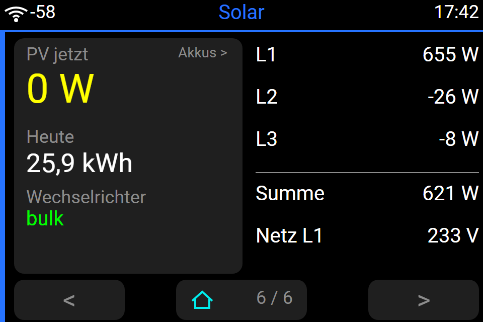

PV-Leistung, Tagesertrag und Wechselrichter-Zustand, rechts die Phasen L1 bis L3 mit Summe und Netzspannung L1.

### Unterseite Warmwasser

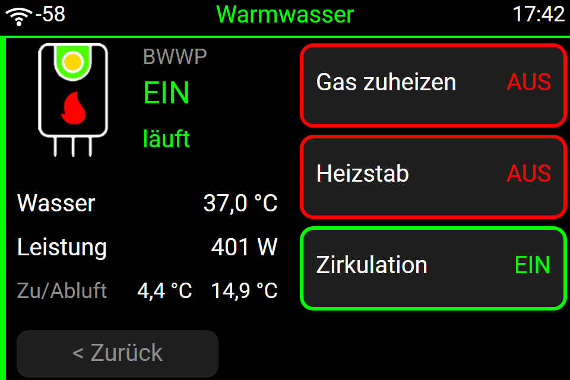

| Schalter | Schaltet |
|---|---|
| Gas zuheizen | `switch.display_buderus_ww_zuheizen` |
| Heizstab | `switch.bwwp_steuerung_esp_lichtsensor_wp_status_led` (Heizstab-Schalter der BWWP-Steuerung) |
| Zirkulation | `switch.shellyplus_zirkulationspumpe` |

Jeder Tipp öffnet zuerst eine Rückfrage. Geschaltet wird erst mit **Ja**.

Der Heizstab wird über den Schalter der BWWP-Steuerung geschaltet, nicht direkt über die Servo-Taste. Die BWWP-Steuerung drückt nur, wenn es nötig ist, prüft das Ergebnis und zeigt sofort den Sollzustand. Über die Servo-Taste stand nach dem Ausschalten noch etwa 2,5 Minuten „an“ in der Anzeige.

### Unterseite Einstellungen

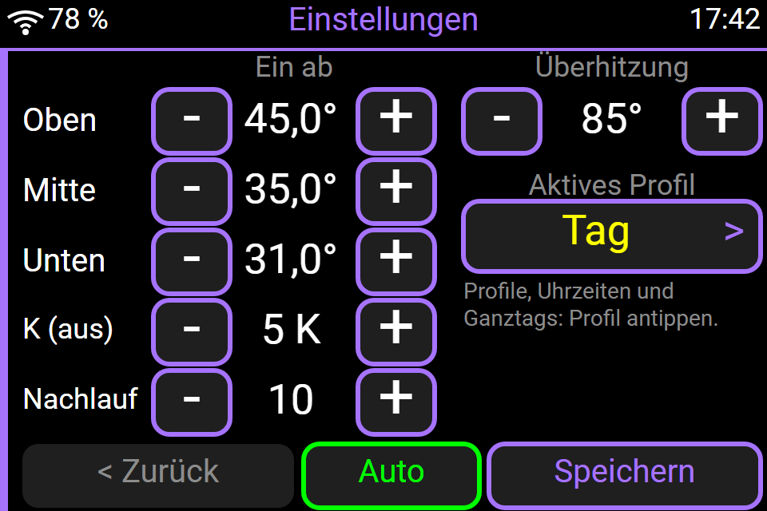

Links stehen die Werte des **gerade aktiven Profils**, rechts der Überhitzungsschutz und das aktive Profil.

| Wert | Bereich | Schritt | Bedeutung |
|---|---|---|---|
| Oben (TO) | 10–90 °C | 0,5 °C | Pumpe Kamin darf einschalten, wenn Puffer oben diesen Wert erreicht |
| Mitte (TM) | 10–90 °C | 0,5 °C | dasselbe für Puffer mitte |
| Unten (TU) | 10–90 °C | 0,5 °C | dasselbe für Puffer unten |
| K (aus) | 1–40 K | 1 K | Hysterese, gilt für alle drei Fühler |
| Nachlauf | 0–60 min | 1 min | so lange muss die Ausschaltgrenze unterschritten sein |
| Überhitzung | 60–95 °C | 1 °C | ab diesem Wert an Puffer oben läuft die Pumpe immer (gilt für beide Profile) |

1. Mit `-` und `+` die Werte ändern. Orange heißt: noch nicht gespeichert.
2. **Speichern** tippen und mit **Ja** bestätigen. Oben, mitte, unten und K landen im **aktiven Profil**, Nachlauf und Überhitzung gelten für beide.

Der Knopf **Auto / Hand** unten in der Mitte schaltet zwischen Automatik (grün) und Handbetrieb (orange), ebenfalls mit Nachfrage. Das Feld **Aktives Profil** öffnet die Profilseite.

Speichern geht über Home Assistant. Ohne Home Assistant lassen sich die Werte am Display nicht ändern, die zuletzt gespeicherten gelten aber weiter.

### Unterseite Profile Tag / Abend

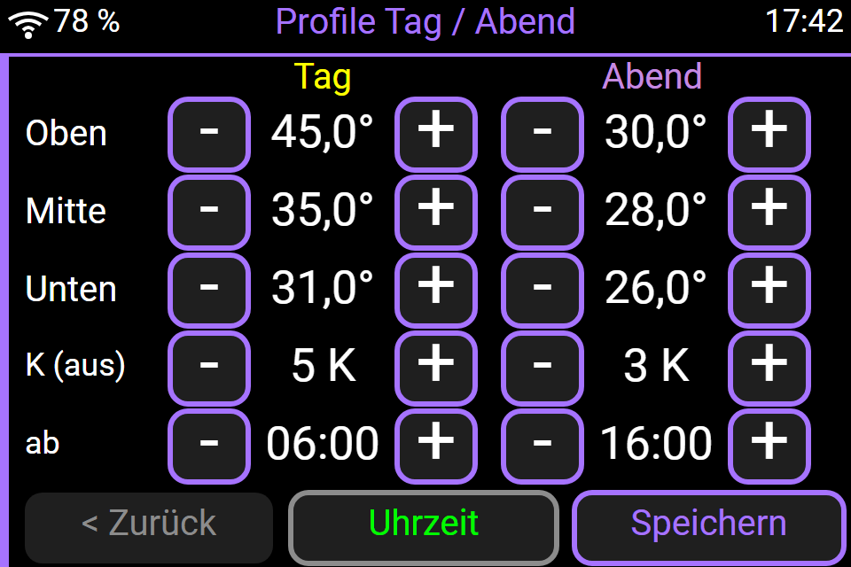

Hier stehen beide Profile nebeneinander, darunter die Uhrzeiten, ab denen sie gelten.

| Zeile | Bereich | Schritt |
|---|---|---|
| Oben, Mitte, Unten | 10–90 °C | 0,5 °C |
| K (aus) | 1–40 K | 1 K |
| ab (Uhrzeit) | 00:00–23:55 | 5 min |

| Knopf | Wirkung |
|---|---|
| **Uhrzeit / Ganztags** | wechselt mit Nachfrage zwischen Umschaltung nach Uhrzeit und „Ganztags“ |
| **Speichern** | schreibt beide Profile und beide Uhrzeiten nach Home Assistant, mit Nachfrage. Rahmen orange = es gibt ungespeicherte Änderungen |
| **< Zurück** | zur Einstellungsseite, Ungespeichertes verfällt |

Bei **Ganztags** gilt immer das Profil Tag. Die Spalte Abend und beide Uhrzeiten sind dann grau und gesperrt:

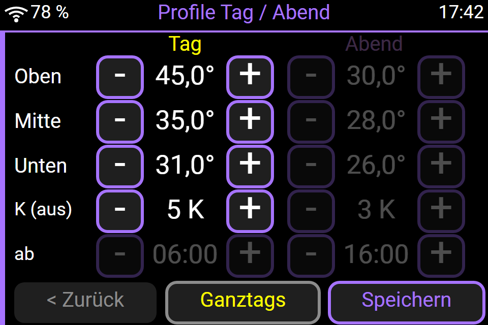

### Unterseite Akkus

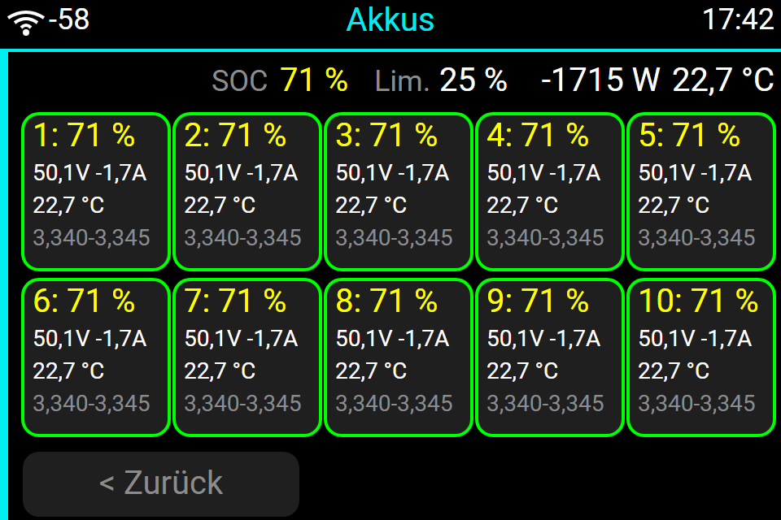

Gesamtwerte des Speichers und für jedes der 10 Pylontech-Module Ladestand, Spannung, Strom, Temperatur und Zellspannungen.

### Admin-Ansicht

Über das **Zahnrad** auf der Übersicht. Vier Seiten, mit `<` und `>` blättern, **< Zurück** führt zur Übersicht.

**Admin 1/4 Netzwerk:** WLAN-Empfang, SSID, IP-Adresse, MAC, Laufzeit seit dem letzten Start und Verbindung zu Home Assistant. Der Knopf **Neustart** startet das Display nach Rückfrage neu.

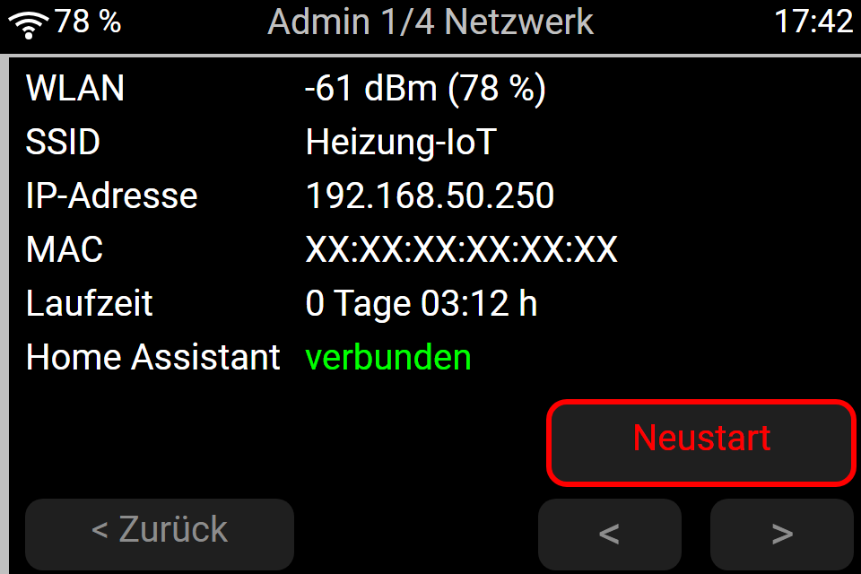

**Admin 2/4 Sensoren:** alle fünf DS18B20 mit Adresse und aktuellem Wert („Fehler“ in Rot, wenn ein Fühler nichts liefert), darunter die Rückmeldungen und der Ausgang.

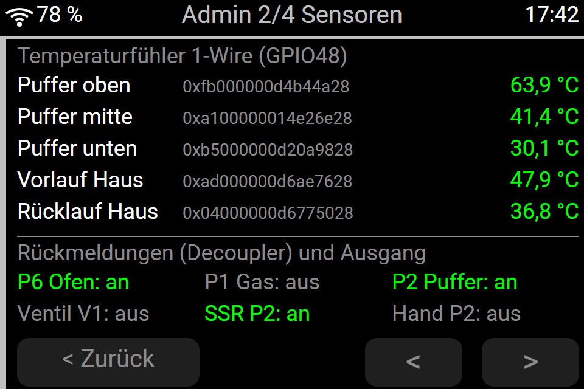

| Anzeige | Bedeutung |
|---|---|
| P6 Ofen | Rücklaufanhebung am Kamin (Decoupler 1) |
| P1 Gas | Pumpe Gas (Decoupler 2) |
| P2 Puffer | Pumpe Kamin, Alpha Puffer → Haus (Decoupler 3) |
| Ventil V1 | 3-Wege-Ventil (Decoupler 4) |
| SSR P2 | Ausgang des Displays zur Pumpe Kamin |
| Hand P2 | Handbetrieb der Pumpe Kamin |

**Admin 3/4 Firmware:** Firmware-Stand (wird bei jeder Änderung hochgezählt), ESPHome-Version, Erstellungszeit, Gerät, Hardware, freier Speicher.

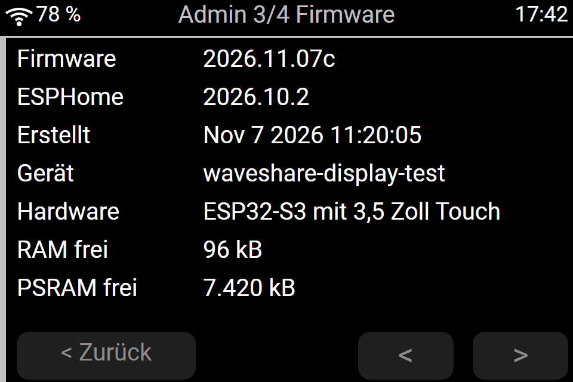

**Admin 4/4 Betreiber:** Anlagenbetreiber mit Telefon und E-Mail (im Repository Platzhalter, eigene Daten in der YAML eintragen).

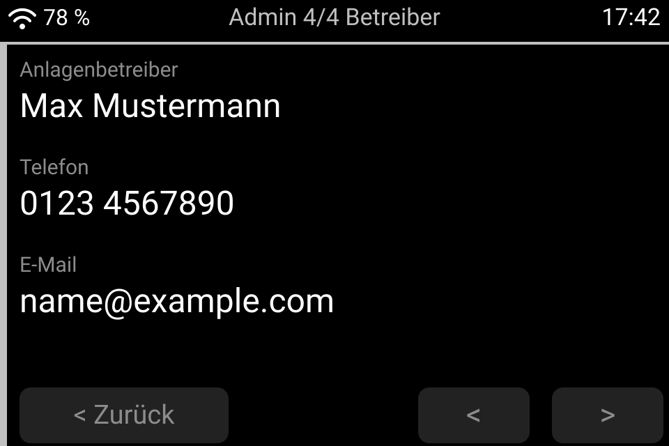

### Testseite Rückmeldungen

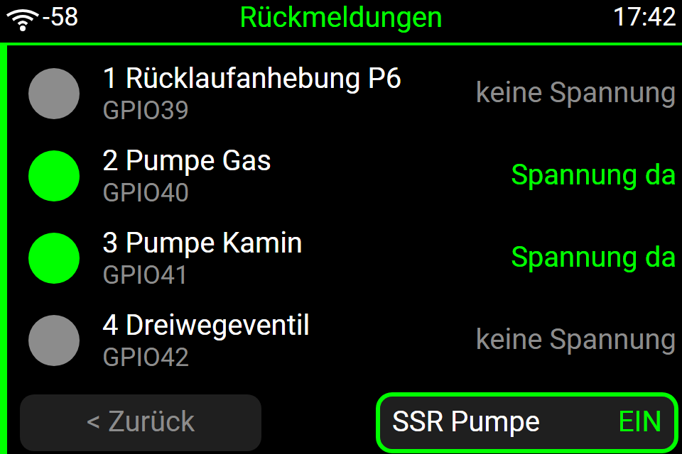

| Punkt | Eingang | Meldet |
|---|---|---|
| 1 Rücklaufanhebung P6 | GPIO39 | Spannung an der Pumpe P6 |
| 2 Pumpe Gas | GPIO40 | Spannung an der Pumpe Gas |
| 3 Pumpe Kamin | GPIO41 | Spannung **hinter** dem SSR, also an Pumpe Kamin und Ventil |
| 4 Dreiwegeventil | GPIO42 | Spannung am 3-Wege-Ventil, das Gas vom Puffer trennt |

Grün = „Spannung da“, grau = „keine Spannung“. Der Knopf **SSR Pumpe** schaltet das SSR direkt, mit Nachfrage. Dabei geht der Handbetrieb nicht automatisch an, die Regelung kann also gleich wieder umschalten.

## 4. Regelung der Pumpe Kamin

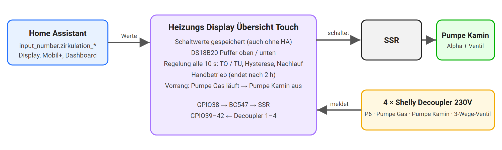

### 4.1 So schaltet die Pumpe

Das Display prüft alle 10 Sekunden, in dieser Reihenfolge:

| Vorrang | Zustand | Bedingung |
|---|---|---|
| 1 | **Überhitzungsschutz** | Puffer oben ≥ Überhitzung: Pumpe **immer an**, auch bei laufender Pumpe Gas und im Handbetrieb. Erst unter Überhitzung − 5 K regelt das Display wieder normal |
| 2 | **Sofort aus** | die **Pumpe Gas läuft** (Rückmeldung Decoupler 2) |
| 3 | **Handbetrieb** | die Temperaturregelung ruht (siehe 4.3) |
| 4 | **Ein** | Puffer oben ≥ TO **und** mitte ≥ TM **und** unten ≥ TU |
| 4 | **Aus** | oben < TO − K **oder** mitte < TM − K **oder** unten < TU − K, und das die ganze Nachlaufzeit lang |

- Ein Fühler ohne Wert zählt wie „zu kalt“, die Pumpe geht nach dem Nachlauf aus.
- Nach einem Neustart sind SSR und Handbetrieb aus, danach regelt das Display normal.
- Die Alpha regelt ihre Leistung selbst herunter, wenn die Thermostate im Haus zumachen. Längeres Laufen schadet also nicht.

**Beispiel** (Profil Tag: TO 45 °C, TM 35 °C, TU 31 °C, K 5, Nachlauf 10 min):

- Ein, sobald oben mindestens 45 °C, mitte 35 °C und unten 31 °C anliegen.
- Aus, wenn oben unter 40 °C, mitte unter 30 °C oder unten unter 26 °C fällt und das 10 Minuten so bleibt.
- Steigt die Temperatur vorher wieder darüber, beginnt die Zeit von vorn.

Im Log steht bei jedem Schalten eine Zeile mit `kamin`, z. B. „TO/TM/TU erreicht -> Pumpe Kamin an“, „Nachlauf abgelaufen -> Pumpe Kamin aus“, „Pumpe Gas laeuft -> Pumpe Kamin aus“ oder „Ueberhitzungsschutz …“.

### 4.2 Profile Tag und Abend

Es gibt zwei Sätze Schaltwerte. So lässt sich der Puffer z. B. tagsüber mit hohen Einschaltwerten laden und abends auch die restliche, niedrigere Wärme nutzen.

| | Profil Tag | Profil Abend |
|---|---|---|
| Ein ab oben / mitte / unten | `input_number.zirkulation_tag_t1` / `_tag_tm` / `_tag_t2` | `input_number.zirkulation_abend_t1` / `_abend_tm` / `_abend_t2` |
| K | `input_number.zirkulation_tag_hyst` | `input_number.zirkulation_abend_hyst` |
| gilt ab | `input_datetime.zirkulation_tag_ab` (6:00) | `input_datetime.zirkulation_abend_ab` (16:00) |

| Helfer | Bedeutung |
|---|---|
| `input_select.zirkulation_profil` | aktives Profil (Tag / Abend) |
| `input_boolean.zirkulation_ganztags` | an = immer Profil Tag, die Uhrzeiten werden nicht beachtet |

Die Automatisierung **„Puffer Kamin – Schaltprofil Tag/Abend“** in Home Assistant:

1. schaltet zu den Uhrzeiten auf Tag bzw. Abend (Abend nur, wenn Ganztags aus ist),
2. wählt nach einem HA-Neustart, beim Umschalten von Ganztags und beim Ändern einer Uhrzeit sofort das passende Profil,
3. kopiert bei jedem Profilwechsel und bei jeder Änderung eines Profilwerts die Werte des aktiven Profils in die Schaltwerte, mit denen das Display regelt (siehe 4.4).

Eigene Regeln, z. B. Anwesenheit oder Wochenende, lassen sich dort als weitere Auslöser und Bedingungen ergänzen. Am Ende genügt es, das Profil umzuschalten, das Kopieren passiert von selbst.

Die Helfer stehen in `config/packages/shelly Heizung/puffer_profile.yaml`.

### 4.3 Handbetrieb

| Bedienung | Wirkung |
|---|---|
| Knopf **Pumpe Kamin** auf Seite Puffer + **Ja** | Handbetrieb an, Pumpe Kamin schaltet um |
| Knopf **Auto / Hand** in den Einstellungen + **Ja** | zwischen Automatik und Handbetrieb wechseln |
| Schalter „Pumpe Kamin Handbetrieb“ in Home Assistant bzw. Mobil+ / Tablet | dasselbe von außen |

- Im Handbetrieb ruht die Temperaturregelung. **Die Pumpe Gas schaltet die Pumpe Kamin trotzdem ab**, der Überhitzungsschutz schaltet sie trotzdem ein.
- Nach **2 Stunden** beendet das Display den Handbetrieb von selbst, auch ohne Home Assistant.

### 4.4 Woher die Schaltwerte kommen

Das Display regelt mit den **aktiven Werten**. Die Automatisierung füllt sie aus dem aktiven Profil.

| Einstellung | Home Assistant (aktiv) | Im Display gespeichert als |
|---|---|---|
| TO oben | `input_number.zirkulation_grenze_t1` | `r_to` |
| TM mitte | `input_number.zirkulation_grenze_tm` | `r_tm` |
| TU unten | `input_number.zirkulation_grenze_t2` | `r_tu` |
| K | `input_number.zirkulation_hysterese` | `r_hy` |
| Nachlauf | `input_number.zirkulation_nachlauf` | `r_nl` |
| Überhitzung | `input_number.zirkulation_ueberhitzung` | `r_max` |

Das Display übernimmt jede Änderung und behält den Wert auch nach einem Neustart und ohne Home Assistant. Diese Helfer stehen in `config/packages/shelly Heizung/inputhelfer.yaml`.

**Ändern** lassen sich die Werte am Display (Einstellungen und Profile), im Dashboard Mobil+ (Ansicht Gas, Karte „Puffer Kamin“) und im Dashboard Tablet (Ansicht Keller, Karte „Steuerung“). Dort werden die **Profilwerte** bearbeitet, nicht die aktiven Werte direkt. In den Dashboards fragt ein Feld erst nach, ob gespeichert werden soll, wenn man es verlässt.

## 5. Hardware und Anschlüsse

### 5.1 SSR und Decoupler

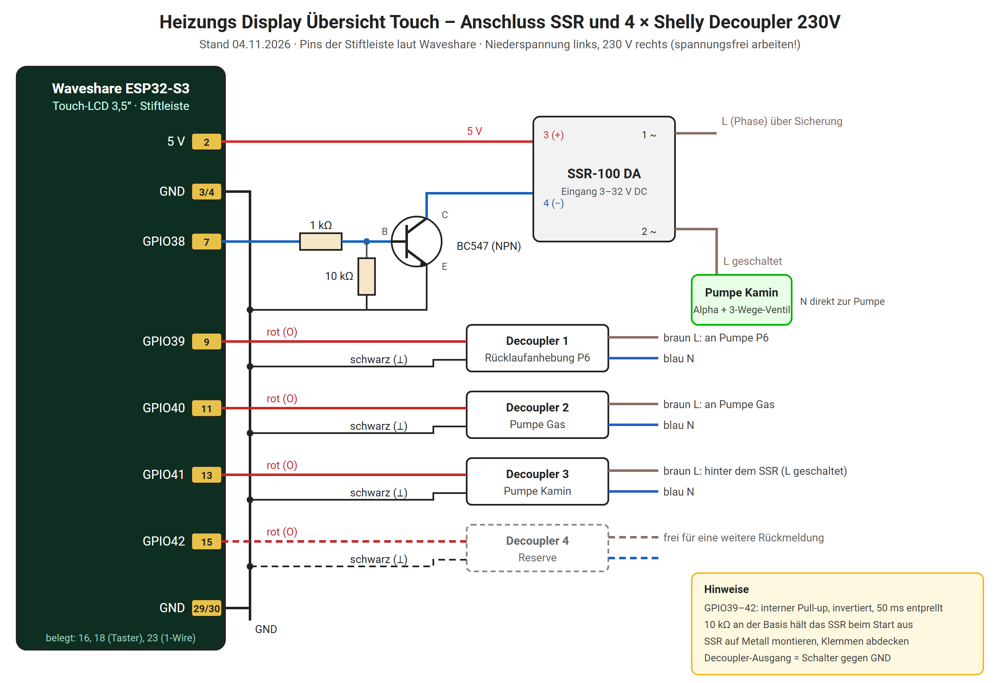

| Funktion | GPIO | Leisten-Pin | Anschluss |
|---|---|---|---|
| SSR schalten | GPIO38 | 7 | über 1 kΩ an die Basis eines BC547, 10 kΩ Basis → GND |
| 5 V für das SSR | – | 2 | an SSR Klemme 3 (+) |
| Decoupler 1 Rücklaufanhebung P6 | GPIO39 | 9 | rote Ader (O) |
| Decoupler 2 Pumpe Gas | GPIO40 | 11 | rote Ader (O) |
| Decoupler 3 Pumpe Kamin | GPIO41 | 13 | rote Ader (O) |
| Decoupler 4 Dreiwegeventil | GPIO42 | 15 | rote Ader (O) |
| GND | – | 3, 4, 29, 30 | Emitter BC547, 10 kΩ, alle schwarzen Adern (⊥) |

**SSR FQFER SSR-100 DA** (Eingang 3–32 V DC, Ausgang 24–380 V AC):

- **3 (+)** an 5 V, **4 (−)** an den Kollektor des BC547, Emitter an GND
- **1** = Phase (L) von der Sicherung, **2** = geschaltete Phase zur Pumpe Kamin
- N und PE gehen direkt zur Pumpe, nicht über das SSR
- Gesteuert wird über den Transistor, weil 3,3 V vom GPIO knapp am Mindestwert von 3 V liegen
- Auf Metall montieren und die Klemmen abdecken

**BC547:** Bei uns geprüft mit hFE 143, Belegung 1 = Kollektor, 2 = Basis, 3 = Emitter (flache Seite zu dir, Beinchen unten: C – B – E).

**Shelly 1-Channel Decoupler 230V:** Der Ausgang ist ein Optokoppler, der bei anliegender Spannung **O (rot) mit ⊥ (schwarz) verbindet**. Er liefert keine eigene Spannung. Am Display mit internem Pull-up, invertiert und 50 ms entprellt. Braun (L) an die Phase der Pumpe, blau an N. Decoupler 3 sitzt **hinter dem SSR** (Klemme 2).

**Achtung beim SSR:** Auch ausgeschaltet lässt es einige mA durch. Bleibt Punkt 3 auf der Testseite grün, obwohl das SSR aus ist, kommt dieser Leckstrom beim Decoupler an. Fällt ein SSR aus, ist es meist dauerhaft durchgeschaltet.

### 5.2 Fühler und Taster

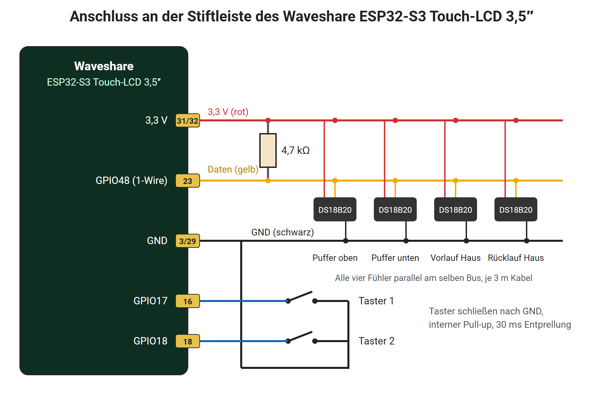

| Anschluss | GPIO | Leisten-Pin |
|---|---|---|
| 1-Wire Daten (alle 5 DS18B20) | GPIO48 | 23 |
| 3,3 V | – | 31 / 32 |
| Taster 1 | GPIO17 | 16 |
| Taster 2 | GPIO18 | 18 |

Zwischen Daten und 3,3 V liegt einmal ein Widerstand mit 4,7 kΩ.

| Einbauort | Adresse | Anzeige | Entität |
|---|---|---|---|
| Puffer oben | `0xfb000000d4b44a28` | PS.-O | `sensor.heizungs_display_ubersicht_touch_puffer_oben` |
| Puffer mitte | `0xa100000014e26e28` | PS.-M | `sensor.heizungs_display_ubersicht_touch_puffer_mitte` |
| Puffer unten | `0xb5000000d20a9828` | PS.-U | `sensor.heizungs_display_ubersicht_touch_puffer_unten` |
| Vorlauf Haus | `0xad000000d6ae7628` | V-Haus | `sensor.heizungs_display_ubersicht_touch_vorlauf_haus` |
| Rücklauf Haus | `0x04000000d6775028` | R-Haus | `sensor.heizungs_display_ubersicht_touch_rucklauf_haus` |

Die Adressen und aktuellen Werte stehen auch auf der Admin-Seite 2.

**Neuen Fühler einbinden:** Das Display gibt seine 1-Wire-Liste nicht im normalen Log aus. Am einfachsten vorübergehend einen Text-Sensor einbauen, der `id(ow_bus)->get_devices()` ausgibt, flashen, die neue Adresse ablesen und den Sensor wieder entfernen. So wurde am 06.11.2026 der Fühler Puffer mitte gefunden.

**Frei an der Leiste:** GPIO21 (Pin 5) und GPIO47 (Pin 21). GPIO45/46 nicht benutzen (Bootverhalten), GPIO9–11 gehören zur SD-Karte.

### 5.3 Fest auf dem Board

| Funktion | Pins |
|---|---|
| I²C (Touch FT6336, IO-Expander PCA9554, Codec ES8311) | SDA GPIO8, SCL GPIO7, 400 kHz |
| SPI Display ST7796 | CLK GPIO5, MOSI GPIO1, MISO GPIO2, DC GPIO3 |
| Display CS und Reset | PCA9554 Ausgang 2 und 1 |
| Beleuchtung | GPIO6 |
| Ton I²S | LRCLK GPIO15, BCLK GPIO13, MCLK GPIO12, DOUT GPIO16 |

## 6. Home Assistant

### 6.1 Vom Gerät

| Entität | Zweck |
|---|---|
| `switch.heizungs_display_ubersicht_touch_pumpe_kamin_ssr` | SSR der Pumpe Kamin |
| `switch.heizungs_display_ubersicht_touch_pumpe_kamin_handbetrieb` | Handbetrieb (endet nach 2 h) |
| `binary_sensor.heizungs_display_ubersicht_touch_ruckmeldung_rucklaufanhebung_p6` | Rückmeldung P6 |
| `binary_sensor.heizungs_display_ubersicht_touch_ruckmeldung_pumpe_gas` | Rückmeldung Pumpe Gas |
| `binary_sensor.heizungs_display_ubersicht_touch_ruckmeldung_pumpe_kamin` | Rückmeldung Pumpe Kamin |
| `binary_sensor.heizungs_display_ubersicht_touch_ruckmeldung_dreiwegeventil` | Rückmeldung 3-Wege-Ventil |
| `sensor.heizungs_display_ubersicht_touch_puffer_oben`, `_puffer_mitte`, `_puffer_unten`, `_vorlauf_haus`, `_rucklauf_haus` | Fühler, auch für Display Buderus, Hans Ofen und die Dashboards |
| `binary_sensor.heizungs_display_ubersicht_touch_taster_1`, `_taster_2` | Taster |
| `light.waveshare_display_test_display_hintergrundbeleuchtung` | Beleuchtung |

### 6.2 Vom Gerät gelesen

| Bereich | Entitäten |
|---|---|
| Ofen | `sensor.aussen_display_buderus_ofen_fuehler` |
| Schaltwerte (aktiv) | `input_number.zirkulation_grenze_t1`, `…_grenze_tm`, `…_grenze_t2`, `…_hysterese`, `…_nachlauf`, `…_ueberhitzung` |
| Profile | `input_select.zirkulation_profil`, `input_boolean.zirkulation_ganztags`, `input_number.zirkulation_tag_*` / `_abend_*`, `input_datetime.zirkulation_tag_ab` / `_abend_ab` |
| Warmwasser | `switch.warmepumpe`, `sensor.warmepumpe_leistung`, `sensor.shellyplus_temperatur_bwwp_puffer_temperature`, `…_lufteinlass_temperature`, `…_luftauslass_temperature`, `switch.shellyplus_zirkulationspumpe`, `switch.bwwp_steuerung_esp_lichtsensor_wp_status_led` |
| Gas | `switch.display_buderus_gas_unterdruecken`, `switch.display_buderus_ww_zuheizen`, `sensor.zahlerstand`, `sensor.verbrauch_energie_heute`, `…_gestern`, `…_vorgestern` |
| Gaskosten | `sensor.gas_energie_*`, `sensor.gas_kosten_*`, `input_number.gasreis_eingabe`, `input_number.gas_grundkosten_monat`, `input_datetime.gas_stichtag` |
| Solar und Akkus | Victron- und Pylontech-Sensoren, siehe Konfiguration |

Damit Schalter und Speichern funktionieren, muss beim ESPHome-Gerät **„Darf Home-Assistant-Aktionen ausführen“** aktiv sein.

### 6.3 Dashboards

**Mobil+, Ansicht Gas**

| Karte | Inhalt |
|---|---|
| Steuerung | u. a. Schalter „Puffer-Pumpe Handbetrieb“ |
| Einstellungen | Gaspreis, Grundkosten, Stichtag, Gassperre, dazu Puffer oben / mitte / unten |
| Puffer Kamin | Tank mit drei Temperaturen, Pumpe Kamin (SSR), Ventil-Anzeige, Chip **Profil** und Schalter **Ganztags / nach Uhrzeit**, beide Profile, Uhrzeiten, Nachlauf, Überhitzungsschutz. Bei Ganztags sind Abend und Uhrzeiten grau |
| Gas pro Tag | letzte 14 Tage; ein Tag antippen zeigt Verbrauch, m³, Kosten, Ø Außen, Ofen max und den Verlauf pro Stunde |
| Verlauf 24 h | Ofen, Puffer oben / mitte / unten, Gasleistung |

**Tablet, Ansicht Keller:** Anlagenschema mit Puffer oben / mitte / unten, Karte **Steuerung** mit Schalter „Puffer Profil Ganztags“ und denselben Profilwerten, Karte **Gas pro Tag**, Verlauf 24 h.

Die Anzeige „Haus aus Puffer / aus Gas“ richtet sich noch nach der Pumpe Gas, nicht nach der Rückmeldung des Dreiwegeventils.

## 7. Ändern und flashen

1. `test-heizung.yaml` im ESPHome-Ordner bearbeiten. Das ist die maßgebliche Datei.
2. In `substitutions` den Wert `fw_version` hochzählen, er erscheint auf Admin-Seite 3.
3. Im Device Builder **Install** klicken (WLAN). Ein **oranger** Punkt hinter dem Gerätenamen heißt: geändert, noch nicht geflasht. **Blau** heißt: ESPHome-Update verfügbar.
4. Danach **mindestens 1 Minute nicht neu starten**, sonst fällt das Display auf die alte Firmware zurück („OTA rollback detected“ im Log).
5. Auf Admin-Seite 3 oder in Home Assistant beim Gerät den Firmware-Stand prüfen.

Ältere Stände liegen in dem Ordner `archive` im ESPHome-Verzeichnis, z. B. `test-heizung_2026-11-07_vor-profilseite.yaml`.

## 8. Einstellungen für flüssigen Betrieb

| Einstellung | Wert |
|---|---|
| Logger | `WARN` |
| CPU | 240 MHz |
| Display SPI | 40 MHz |
| I²C | 400 kHz |
| Touch-Abfrage | alle 20 ms |
| LVGL-Touch-Auswertung | alle 10 ms (sonst ~33 ms, dann gehen kurze Tipper verloren) |
| Seiten | nicht scrollbar |
| LVGL-Puffer | 25 % |
| Seitenwechsel | ohne Animation |
| Schnelle Werte | höchstens alle 5 s neu zeichnen, Akku-Module alle 15 s |
| Aufwecken | jede Berührung bei dunkler Beleuchtung schaltet das Licht ein, eine Prüfung jede Sekunde startet die Anzeige |

## 9. Wenn etwas nicht geht

| Beobachtung | Mögliche Ursache | Was tun |
|---|---|---|
| Pumpe Kamin läuft nie | Pumpe Gas läuft (Vorrang) oder ein Puffer-Fühler unter seinem Wert | Seite Puffer, Admin-Seite 2 und Log nach `kamin` ansehen |
| Pumpe Kamin läuft, obwohl der Puffer kalt ist | Handbetrieb an oder Überhitzungsschutz | Auto / Hand und Puffer oben prüfen |
| Pumpe Kamin läuft, Display zeigt „aus“ | SSR defekt (durchgeschaltet) oder Pumpe anders versorgt | Rückmeldung 3 und Verdrahtung prüfen |
| Punkt 3 grün, obwohl SSR aus | Leckstrom des SSR | Belastung prüfen, sonst mechanisches Relais |
| Profil wechselt nicht um 16:00 | Ganztags an oder Automatisierung aus | Schalter Ganztags und Automatisierung „Puffer Kamin – Schaltprofil Tag/Abend“ prüfen |
| Ein DS18B20 zeigt „Fehler“ | Wackelkontakt oder Fühler defekt | Admin-Seite 2, Kontakte prüfen, Display neu starten |
| Erster Tipp tut nichts | Display war dunkel, der Tipp weckt nur | nochmal tippen |
| Tipp wird gehört, aber nicht ausgeführt | zu kurzer Tipp | seit Firmware 2026.11.06b behoben, sonst etwas länger drücken |
| Heizstab zeigt nach dem Ausschalten noch „an“ | ältere Firmware schaltete direkt die Servo-Taste | Firmware ab 2026.11.07c flashen |
| Pumpe Kamin geht nach wenigen Minuten aus, ohne Nachlauf | Fehler in der Nachlauf-Zeitmessung bis Firmware 2026.11.07c | Firmware ab 2026.11.14 flashen |
| Pumpe von Hand eingeschaltet, geht gleich wieder aus | SSR direkt geschaltet, ohne Handbetrieb | Knopf **Pumpe Kamin** auf der Seite Puffer benutzen, der setzt den Handbetrieb |
| Nach dem Flashen alte Version | in der ersten Minute neu gestartet | nochmal flashen, 1 Minute warten |
| Kästchen statt Buchstaben | Zeichen fehlt in der großen Schrift | bei `glyphs` von `f40` ergänzen |

## 10. Noch offen

- Bedeutung der Rückmeldung Dreiwegeventil festlegen (Spannung = Gas oder Puffer), dann in die Dashboard-Anzeige übernehmen
- Leckstrom-Test SSR mit angeschlossener Pumpe
- Taster 1 und 2 haben noch keine Funktion
- Grundfos ALPHA3 über Bluetooth auslesen, sobald die Pumpen da sind

## Versionen

Die Firmware-Version steht in der YAML unter `substitutions: fw_version` und auf Admin-Seite 3.

| Version | Datum | Änderungen |
|---|---|---|
| 2026.11.14 | 14.11.2026 | **Fehlerbehebung Nachlauf:** Die Pumpe Kamin ging oft sofort aus, sobald ein Puffer-Fühler unter seinen Wert minus K fiel, statt erst nach der Nachlaufzeit. Ursache: Beim ersten Unterschreiten wurde die Zeit im selben Durchlauf geprüft, `millis() \| 1` konnte 1 ms in der Zukunft liegen und die Differenz lief über. Jetzt startet das erste Unterschreiten nur die Zeitmessung, geprüft wird ab dem nächsten Durchlauf. Ein ungültiger Nachlaufwert gilt als 10 min |
| 2026.11.07c | 07.11.2026 | Heizstab über den Schalter der BWWP-Steuerung statt über die Servo-Taste |
| 2026.11.07b | 07.11.2026 | Seite Profile Tag / Abend mit Uhrzeiten (5 min) und Ganztags |
| 2026.11.07 | 07.11.2026 | Profile Tag / Abend aus Home Assistant, wieder ein K-Wert für alle drei Fühler |
| 2026.11.06d | 06.11.2026 | Einstellungen: Nachlauf ohne „min“, damit nichts in die nächste Zeile rutscht |
| 2026.11.06c | 06.11.2026 | Überhitzungsschutz (Puffer oben, einstellbar), vorübergehend eigene K-Werte je Fühler |
| 2026.11.06b | 06.11.2026 | Touch-Auswertung alle 10 ms (kurze Tipper gingen verloren), eindeutige Pumpennamen auf Admin 2 |
| 2026.11.06 | 06.11.2026 | Admin-Ansicht (Netzwerk, Sensoren, Firmware, Betreiber), Seiten nicht mehr scrollbar |
| – | 06.11.2026 | Fühler Puffer mitte, Grenze TM, neue Puffer-Seite |
| – | 05.11.2026 | Regelung der Pumpe Kamin über SSR im Display, vier Shelly Decoupler als Rückmeldung |

## Dateien im Repository

| Datei | Inhalt |
|---|---|
| `heizungs-display-uebersicht-touch.yaml` | ESPHome-Konfiguration (Betreiberdaten auf Admin 4 sind Platzhalter) |
| `heizungs-display/helpers.h`, `heizungs-display/akku-modul.yaml` | Hilfsfunktionen und Akku-Paket |
| `image/` | Symbole für die Anzeige |
| `home-assistant/inputhelfer.yaml`, `home-assistant/puffer_profile.yaml` | HA-Pakete mit den Grenzwerten und den Profilen Tag/Abend |
| `secrets.yaml.example` | Vorlage für die `secrets.yaml` |
| `shelly/zirkulation.js` | altes Shelly-Skript, wird seit 05.11.2026 nicht mehr benutzt (Regelung läuft auf dem Display) |
| `docs/` | Bilder der Seiten, Schaltbild, Signalweg, Anschlussplan |
