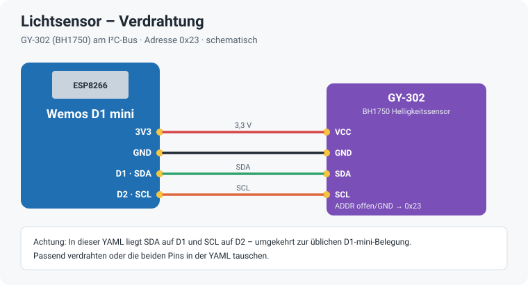
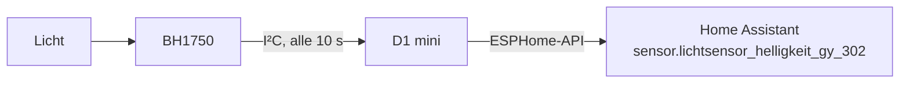

# Lichtsensor – ESPHome

Einfacher Helligkeitssensor: Ein **Wemos D1 mini** mit einem **GY-302 (BH1750)** misst die Helligkeit in Lux und meldet sie alle 10 Sekunden an Home Assistant – z. B. für Licht-Automationen oder um die Rollläden nach der Helligkeit zu steuern.



## Hardware

| Teil | Hinweis |
|---|---|
| **Wemos D1 mini** (ESP8266) | Versorgung über Micro-USB mit einem 5-V-Netzteil |
| **GY-302** | Modul mit BH1750-Helligkeitssensor, I²C-Adresse `0x23` (ADDR offen oder an GND) |

| D1 mini | GY-302 |
|---|---|
| 3V3 | VCC |
| GND | GND |
| D1 | SDA |
| D2 | SCL |

> **Achtung:** In dieser YAML liegt SDA auf **D1** und SCL auf **D2** – umgekehrt zur üblichen Belegung des D1 mini. Entweder genau so verdrahten oder in der YAML `sda` und `scl` tauschen. Beim Start sucht ESPHome den Bus ab (`scan: true`); im Log muss die Adresse `0x23` auftauchen.

## So läuft es



## Installation

1. `lichtsensor.yaml` in den ESPHome-Ordner kopieren.
2. Die Zeilen aus `secrets.yaml.example` in die eigene `secrets.yaml` übernehmen und eigene Werte eintragen.
3. Feste IP unter `wifi: manual_ip:` anpassen oder den Block entfernen.
4. Beim ersten Mal per USB flashen, danach per OTA.
5. In Home Assistant unter Einstellungen → Geräte & Dienste → ESPHome hinzufügen.

## Sensor in Home Assistant

| Entität | Bedeutung |
|---|---|
| `sensor.lichtsensor_helligkeit_gy_302` | Helligkeit in lx |

## Dateien

```
lichtsensor.yaml       ESPHome-Konfiguration
secrets.yaml.example   Vorlage für secrets.yaml (nicht ins Repo!)
docs/                  Verdrahtung
.gitignore             hält secrets.yaml und den Build-Ordner aus dem Repo
```
