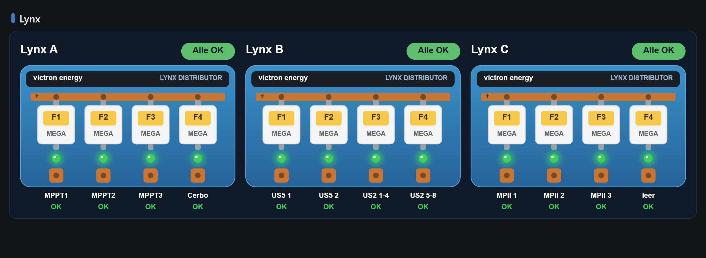
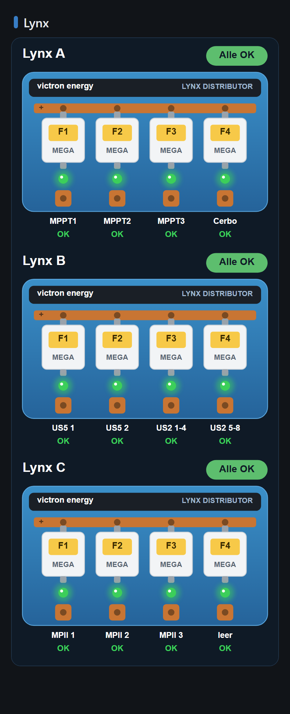
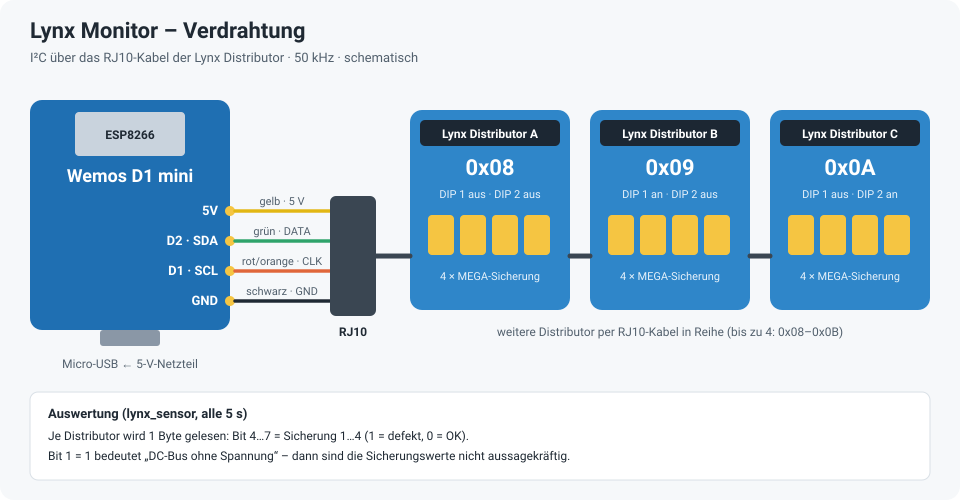
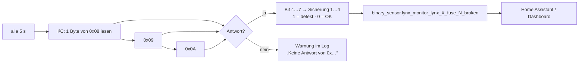

# Lynx Monitor – ESPHome

Überwacht die **MEGA-Sicherungen** in bis zu drei Victron **Lynx Distributor** ohne Victron-Zubehör: Ein Wemos D1 mini hängt am I²C-Bus, der im RJ10-Kabel der Distributor steckt, fragt jeden Distributor alle 5 Sekunden ab und meldet jede Sicherung als eigenen Sensor an Home Assistant.

Die Idee und die Auswertung der Bits stammen aus dem Projekt [**esphome-victron-energy-lynx-distributor**](https://github.com/jcollasius/esphome-victron-energy-lynx-distributor) von jcollasius. Diese Version läuft auf einem ESP8266 (D1 mini), liest drei Distributor gleichzeitig und ist als ESPHome-`external_component` umgesetzt.

> **Achtung:** Das ist kein offizielles Victron-Zubehör und die Verdrahtung hat keine galvanische Trennung. Nachbau auf eigene Verantwortung – vorher die Hinweise im Originalprojekt lesen.

Im Dashboard [**Solar Übersicht V2**](https://github.com/ossilampe/HA-Dashboards/tree/main/Solar%20Uebersicht/V2) sieht das so aus:



<details>
<summary>Handy-Ansicht</summary>



</details>

## Hardware

| Teil | Hinweis |
|---|---|
| **Wemos D1 mini** (ESP8266) | Versorgung über Micro-USB mit einem 5-V-Netzteil |
| **RJ10-Kabel** | Ein Ende abschneiden und an den D1 mini löten, das andere in den ersten Distributor |
| **Lynx Distributor** | Hier drei Stück (A, B, C), untereinander mit RJ10-Kabeln verbunden. Die Adresse wird je Distributor mit dem 2-fach-DIP-Schalter eingestellt. |



| RJ10-Ader (wie im Originalprojekt) | Funktion | D1 mini |
|---|---|---|
| gelb | 5 V | 5V |
| grün | DATA (SDA) | D2 · GPIO4 |
| rot / orange | CLOCK (SCL) | D1 · GPIO5 |
| schwarz | GND | GND |

| Distributor | I²C-Adresse | DIP 1 | DIP 2 |
|---|---|---|---|
| A | `0x08` | aus | aus |
| B | `0x09` | an | aus |
| C | `0x0A` | aus | an |
| (D) | `0x0B` | an | an |

> Die Zeichnung ist schematisch, die Aderfarben stammen aus dem Originalprojekt und können je nach Kabel abweichen – vor dem Einschalten durchmessen. Es gibt keinen Verpolungsschutz.

## So läuft die Abfrage



Bit 1 des Bytes meldet „DC-Bus ohne Spannung“. Dann können die Distributor die Sicherungen nicht prüfen und die Werte sind nicht aussagekräftig – die Komponente wertet dieses Bit derzeit nicht aus.

## Installation

1. `lynx-monitor.yaml` und den Ordner `custom_components/lynx_sensor` in den ESPHome-Ordner kopieren (die Struktur muss erhalten bleiben: `custom_components/lynx_sensor/__init__.py` und `lynx_sensor.h`).
2. Die Zeilen aus `secrets.yaml.example` in die eigene `secrets.yaml` übernehmen und eigene Werte eintragen.
3. Feste IP unter `wifi: manual_ip:` an das eigene Netz anpassen oder den Block entfernen.
4. Weniger als drei Distributor? In `custom_components/lynx_sensor/lynx_sensor.h` die Liste `addresses` kürzen und in der YAML die überzähligen `binary_sensor` löschen.
5. Beim ersten Mal per USB flashen, danach per OTA.
6. In Home Assistant unter Einstellungen → Geräte & Dienste → ESPHome hinzufügen.

Beim Start sucht ESPHome den I²C-Bus ab (`scan: true`) – im Log sollten die Adressen `0x08`, `0x09` und `0x0A` auftauchen. Zusätzlich gibt es eine kleine Weboberfläche auf Port 80.

## Sensoren in Home Assistant

| Entität | Bedeutung |
|---|---|
| `binary_sensor.lynx_monitor_lynx_a_fuse_1_broken` … `_a_fuse_4_broken` | Sicherungen 1–4 im Distributor A – `on` = defekt |
| `binary_sensor.lynx_monitor_lynx_b_fuse_1_broken` … `_b_fuse_4_broken` | Distributor B |
| `binary_sensor.lynx_monitor_lynx_c_fuse_1_broken` … `_c_fuse_4_broken` | Distributor C |

## Dateien

```
lynx-monitor.yaml                          ESPHome-Konfiguration
custom_components/lynx_sensor/__init__.py  ESPHome-Komponente (Konfiguration)
custom_components/lynx_sensor/lynx_sensor.h  Abfrage der Distributor über I²C
secrets.yaml.example                       Vorlage für secrets.yaml (nicht ins Repo!)
docs/                                      Verdrahtung und Dashboard-Bilder
.gitignore                                 hält secrets.yaml und den Build-Ordner aus dem Repo
```
