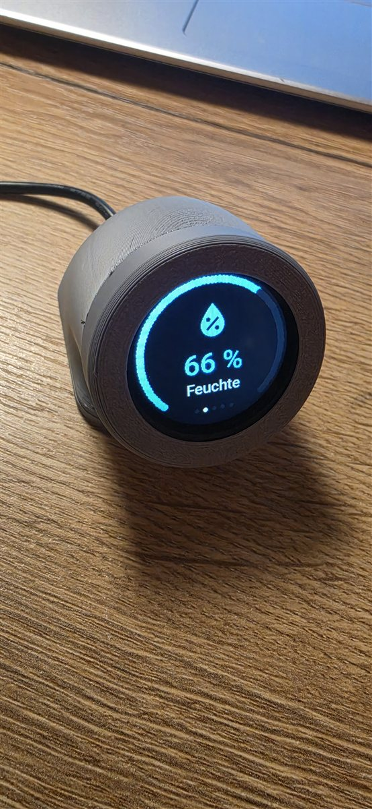
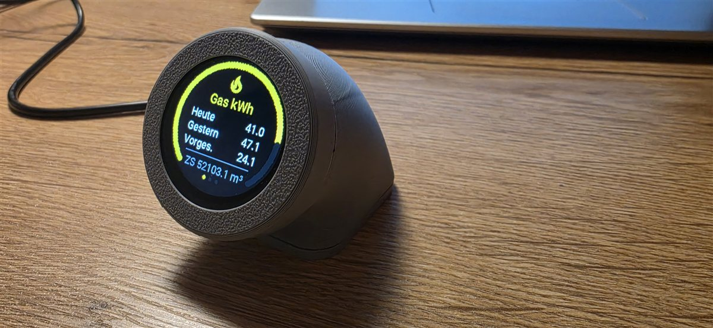
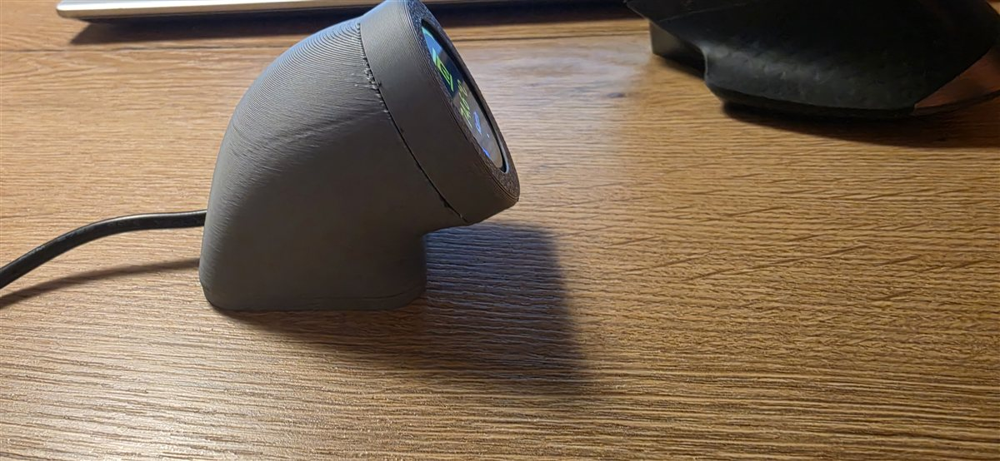
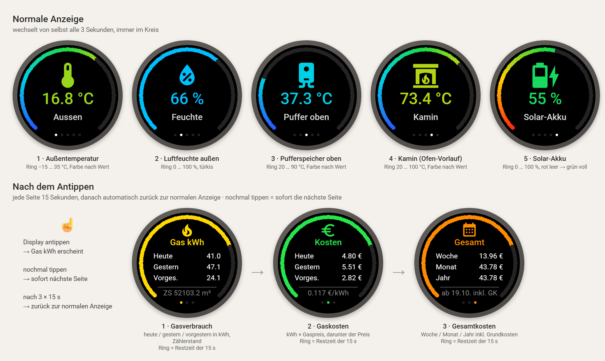

# Ofen Display Tisch – ESPHome

Rundes Touch-Display für den Tisch: Ein **Waveshare ESP32-S3-Touch-LCD-1.28** in einem 3D-gedruckten Gehäuse zeigt im 3-Sekunden-Wechsel dieselben fünf Werte wie das alte [Display Ofen](../Display%20Ofen), jetzt mit bunten Symbolen auf schwarzem Hintergrund. **Beim Antippen** kommen Gasverbrauch und Gaskosten, wie auf den Seiten Gas, Kosten und Gesamt von [Display Buderus](../Display%20Buderus).

<p>
  
  
  
</p>

## Seiten



> Die Seiten oben sind Vorschauen, die aus dem Zeichen-Code der YAML mit echten Werten nachgebaut sind. Die Fotos weiter oben zeigen das echte Gerät.

### Normale Anzeige (Wechsel alle 3 s)

| Seite | Symbol | Wert | Ring und Farbe |
|---|---|---|---|
| Aussen | Thermometer | Außentemperatur | −15 … 35 °C, Farbverlauf blau → rot |
| Feuchte | Tropfen mit % | Luftfeuchte außen | 0 … 100 %, türkis |
| Puffer oben | Boiler | Pufferspeicher oben | 20 … 90 °C, Farbverlauf blau → rot |
| Kamin | Kamin | Ofen-Vorlauf | 20 … 100 °C, Farbverlauf blau → rot |
| Solar-Akku | Akku, je nach Ladestand | SOC | 0 … 100 %, rot (leer) → grün (voll) |

- Der **Ring** am Rand (270°, unten offen) zeigt, wo der Wert in seinem Bereich liegt. Symbol und Zahl haben dieselbe Farbe wie der Wert.
- Die **Punkte** unten zeigen die aktuelle Seite.
- Ohne Verbindung zu Home Assistant steht unter dem Wert ein rotes **OFFLINE**. Fehlt ein Wert, steht dort `--`.

### Nach dem Antippen (je 15 s)

| Seite | Inhalt |
|---|---|
| Gas kWh (gelb) | Verbrauch heute / gestern / vorgestern in kWh, darunter der Zählerstand in m³ |
| Kosten (grün) | Kosten heute / gestern / vorgestern = kWh × Gaspreis, darunter der Gaspreis pro kWh |
| Gesamt (orange) | Kosten Woche / Monat / Jahr ab Stichtag inkl. Grundkosten (rechnet Home Assistant) |

### So funktioniert der Touch

| Was passiert | Ergebnis |
|---|---|
| Einmal antippen (egal wo, egal auf welcher normalen Seite) | Seite **Gas kWh** erscheint |
| Nichts tun | nach 15 s **Kosten**, nach weiteren 15 s **Gesamt**, nach weiteren 15 s zurück zur normalen Anzeige (insgesamt 45 s) |
| Während einer Verbrauchsseite antippen | sofort die **nächste** Seite, sie bleibt wieder volle 15 s |
| Auf **Gesamt** antippen | sofort zurück zur normalen Anzeige |

- Der Ring am Rand läuft auf den Verbrauchsseiten als **Restzeit** ab: voll beim Erscheinen, leer wenn die nächste Seite kommt.
- Die drei Punkte unten zeigen, auf welcher Verbrauchsseite man ist.
- Solange eine Verbrauchsseite zu sehen ist, wartet der normale 3-s-Wechsel. Danach geht es mit der Seite weiter, auf der man vorher war.
- Die Zeit pro Seite steht oben in der YAML: `verbrauch_sekunden: "15"`.

## Hardware

| Teil | Hinweis |
|---|---|
| **Waveshare ESP32-S3-Touch-LCD-1.28** | ESP32-S3, 16 MB Flash, 2 MB PSRAM, rundes 1,28″-Display 240 × 240 (GC9A01A), Touch CST816S |
| Versorgung | USB-C, 5-V-Netzteil |

Alles sitzt auf der Platine, es muss nichts verdrahtet werden. Die Pins in der YAML:

| Funktion | GPIO |
|---|---|
| Display SPI: CLK / MOSI / MISO | 10 / 11 / 12 |
| Display CS / DC / RST | 9 / 8 / 14 |
| Hintergrundbeleuchtung (PWM) | 2 |
| Touch I²C: SDA / SCL | 6 / 7 |
| Touch INT / RST | 5 / 13 |

## Gehäuse (3D-Druck)

Das Gehäuse gibt es auch auf **MakerWorld** zum direkten Drucken: [Touch Display for my desk](https://makerworld.com/de/models/3509065-touch-display-for-my-desk#profileId-4009542)

Die Teile liegen außerdem im Ordner [`druck/`](druck):

| Datei | Teil | Größe |
|---|---|---|
| `Base.stl` | Gehäuse (der Bogen) | 50 × 52 × 59 mm |
| `Base.3mf` | Druckprojekt (Bambu Studio) mit allen drei Teilen auf einer Platte | |
| `Display halter.stl` | Ring vorne, hält das Display | Ø 50 × 10 mm |
| `Fus.stl` | Fuß | 50 × 28 × 45 mm |
| `Display Hans 1,28 Rund.f3d` | Fusion-360-Quelldatei zum Anpassen | |

## In Home Assistant

### Vom Gerät

| Entität | Zweck |
|---|---|
| Hintergrundbeleuchtung | Licht, Helligkeit einstellbar |
| Restart | Neustart des ESP |

### Vom Gerät gelesen

| Anzeige | Entität |
|---|---|
| Aussen, Feuchte | `sensor.mittelwert_temperatur_aussen`, `sensor.mittelwert_huminity_aussen` |
| Puffer oben | `sensor.temperaturfuehler_puffer_oben_temperatur_ch1` |
| Kamin | `sensor.temperaturfuehler_puffer_2_temperaturfuehler_puffer_ofen2_temperatur_ch1` |
| Solar-Akku | `sensor.victron_battery_soc` |
| Gas-Zählerstand, Verbrauch | `sensor.zahlerstand`, `sensor.verbrauch_energie_heute/_gestern/_vorgestern` |
| Gaspreis | `input_number.gasreis_eingabe` (EUR/kWh) |
| Kosten Woche / Monat / Jahr | `sensor.gas_kosten_woche`, `sensor.gas_kosten_monat`, `sensor.gas_kosten_seit_stichtag` |
| Stichtag | `input_datetime.gas_stichtag` |

Wie die Gaskosten für Woche, Monat und Jahr in Home Assistant entstehen, steht bei [Display Buderus](../Display%20Buderus#gaskosten-woche--monat--jahr).

## Installation

1. `ofen-display-tisch.yaml` in den ESPHome-Ordner kopieren.
2. Die Zeilen aus `secrets.yaml.example` in die eigene `secrets.yaml` übernehmen und eigene Werte eintragen.
3. Die Entitäten (siehe oben) an das eigene Home Assistant anpassen.
4. Beim ersten Mal per USB flashen, danach per OTA.

## Hinweise

- **Gerätename:** In der YAML heißt das Gerät `display-hans-ofen-neu`, so ist es in Home Assistant angelegt. Ein neuer Name würde ein neues Gerät in HA ergeben.
- **Farben:** Das Display braucht `invert_colors: true` und `color_order: bgr`. Mit anderen Einstellungen wird der Hintergrund weiß oder rot und blau sind vertauscht.
- **Symbole** sind Material Design Icons (`mdi:…`), einfarbig gespeichert und erst beim Zeichnen eingefärbt. So kostet ein buntes Symbol nicht mehr Speicher als ein einfarbiges.
- **Schrift mit € und ³:** Gibt man bei einer Schrift `glyphs:` an, fällt der Standard-Zeichensatz weg, deshalb steht `glyphsets: [GF_Latin_Kernel]` mit dabei.

## Dateien

```
ofen-display-tisch.yaml   ESPHome-Konfiguration
secrets.yaml.example      Vorlage für secrets.yaml (nicht ins Repo!)
druck/                    3D-Druckteile (STL, 3MF, Fusion 360)
docs/                     Fotos
```
