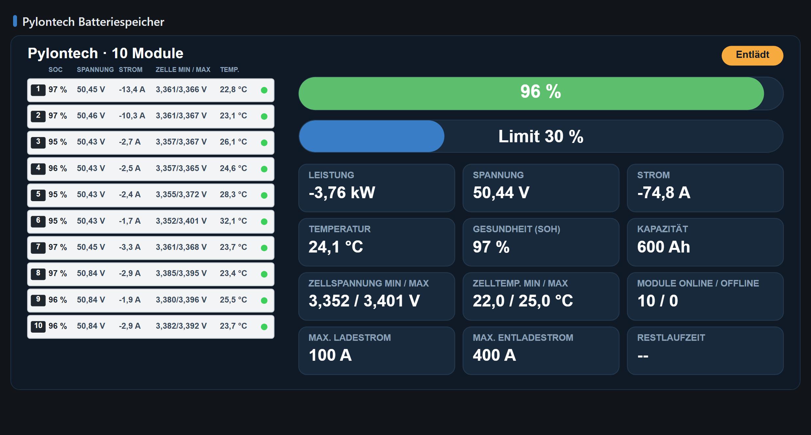
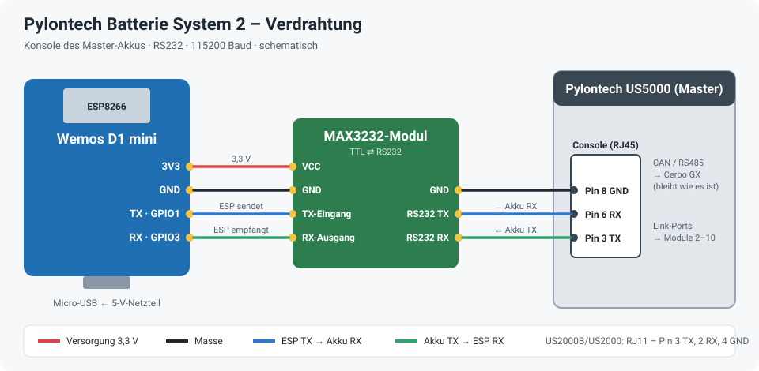
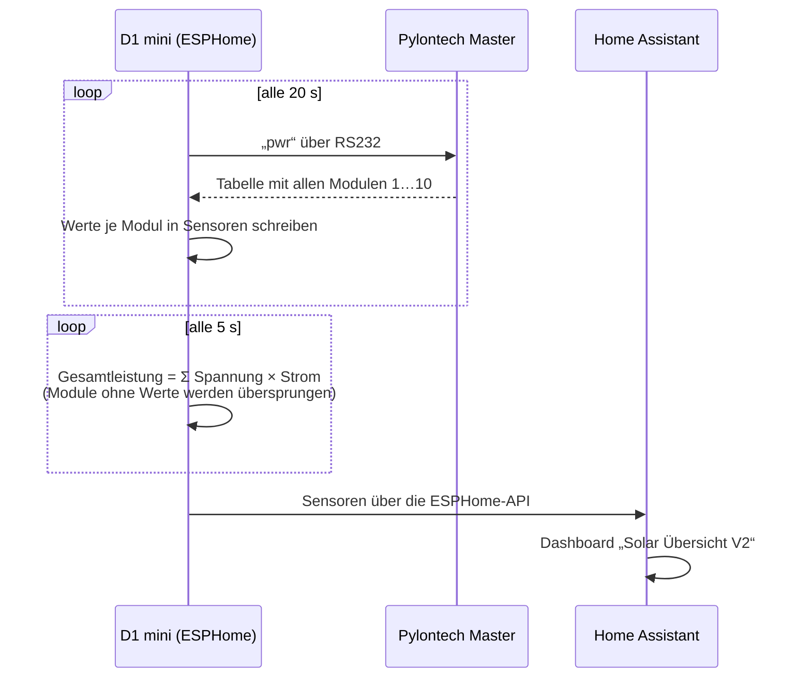

# Pylontech Batterie System 2 – ESPHome

Liest einen Pylontech-Akkustapel über die **Konsole des Master-Akkus** aus und meldet die Werte **jedes einzelnen Moduls** an Home Assistant: Spannung, Strom, Ladezustand (SOC), Temperatur und die niedrigste/höchste Zellspannung. Dazu kommen Gesamtleistung sowie geladene und entladene Energie für das Energie-Dashboard.

Gebaut mit der fertigen ESPHome-Komponente [**Pylontech Battery**](https://esphome.io/components/pylontech/). Die Verbindung von Akku zu Wechselrichter/Cerbo (CAN oder RS485) bleibt dabei unberührt.

Die Werte werden im Dashboard [**Solar Übersicht V2**](https://github.com/ossilampe/HA-Dashboards/tree/main/Solar%20Uebersicht/V2) angezeigt:



<details>
<summary>Handy-Ansicht</summary>


</details>

## Hardware

| Teil | Hinweis |
|---|---|
| **Wemos D1 mini** (ESP8266) | Versorgung über Micro-USB mit einem 5-V-Netzteil |
| **MAX3232-Modul** (RS232 ⇄ TTL) | Pflicht – die Konsole arbeitet mit RS232-Pegeln, die nicht direkt an den ESP dürfen. Am 3,3-V-Pin des D1 mini betreiben. |
| **Kabel zur Konsole** | RJ45 bei US5000 / US3000C / US2000C, RJ11 bei US2000B / US2000 |
| **Akkus** | Hier 10 Module: 2× US5000 + 8× US2000, untereinander über die Link-Ports verbunden. Angeschlossen wird nur der **Master**. |



| D1 mini | MAX3232 (TTL-Seite) | MAX3232 (RS232-Seite) | Pylontech Console RJ45 |
|---|---|---|---|
| 3V3 | VCC | | |
| GND | GND | GND | Pin 8 (GND) |
| TX · GPIO1 | TX-Eingang (T1IN) | RS232 TX (T1OUT) | Pin 6 (Akku RX) |
| RX · GPIO3 | RX-Ausgang (R1OUT) | RS232 RX (R1IN) | Pin 3 (Akku TX) |

Bei RJ11 (US2000B/US2000): Pin 3 = Akku TX, Pin 2 = Akku RX, Pin 4 = GND. Pinbelegung laut [ESPHome-Dokumentation](https://esphome.io/components/pylontech/).

> Die Zeichnung ist schematisch. Die Beschriftung der TTL-Pins unterscheidet sich je nach MAX3232-Modul – im Zweifel RX und TX tauschen, das schadet nicht.

**Warum GPIO1/GPIO3?** Das ist der Hardware-UART des ESP8266 – bei 115200 Baud deutlich zuverlässiger als ein Software-UART. Das Log läuft deshalb über `UART1` (GPIO2) bzw. per WLAN. Im Betrieb kein USB-Datenkabel am D1 mini lassen, sonst stört der USB-Chip auf derselben Leitung; neue Firmware per OTA aufspielen.

## So läuft die Abfrage



## Installation

1. `pylontech-batterie-system-2.yaml` in den ESPHome-Ordner kopieren (ESPHome Device Builder).
2. Die Zeilen aus `secrets.yaml.example` in die eigene `secrets.yaml` übernehmen und eigene Werte eintragen (WLAN, API-Schlüssel, OTA- und Hotspot-Passwort).
3. Feste IP unter `wifi: manual_ip:` an das eigene Netz anpassen oder den Block entfernen.
4. Anzahl der Module anpassen: Je Modul gibt es einen Block `- platform: pylontech` mit `battery: N` (1 = Master). Überzählige Blöcke löschen und in der Leistungsberechnung (`pylontech_power`) die Listen und die Schleife (`i < 10`) anpassen.
5. Beim ersten Mal per USB flashen, danach per OTA (**Install → Wirelessly**).
6. In Home Assistant unter Einstellungen → Geräte & Dienste → ESPHome hinzufügen.

## Sensoren in Home Assistant

| Was | Entitäten |
|---|---|
| Je Modul 1…10 | `sensor.pylontech_batterie_system_2_battery<N>_voltage`, `_current`, `_state_of_charge`, `_temperatur`, `_zelle_min_spannung`, `_zelle_max_spannung` |
| Nur Modul 1 (Master) | `_temp_mosfet`, `_zelle_min_temperatur`, `_zelle_max_temperatur` sowie die Textsensoren `_base_state` (Charge/Dischg/Idle), `_spannungs_state`, `_strom_state`, `_temperatur_state` |
| Gesamt | `sensor.pylontech_batterie_system_2_pylontech_power` (W, + = laden), `_pylontech_charging` und `_pylontech_discharging` (Wh, fürs Energie-Dashboard) |

## Hinweise

- **Keine Werte?** Im ESPHome-Log steht dank `uart: debug:` jede gesendete und empfangene Zeile. Kommt nur `>>> pwr` und keine Antwort, liegt es an Kabel, Pegelwandler oder vertauschtem RX/TX.
- **Ein Modul bleibt leer:** Es antwortet nicht in der `pwr`-Tabelle (falsche Nummer im Stapel oder Modul aus). Die Gesamtleistung rechnet trotzdem mit den übrigen Modulen weiter.
- **Strom:** positiv = Laden, negativ = Entladen.

## Dateien

```
pylontech-batterie-system-2.yaml   ESPHome-Konfiguration
secrets.yaml.example               Vorlage für secrets.yaml (nicht ins Repo!)
docs/                              Verdrahtung und Dashboard-Bilder
.gitignore                         hält secrets.yaml und den Build-Ordner aus dem Repo
```
