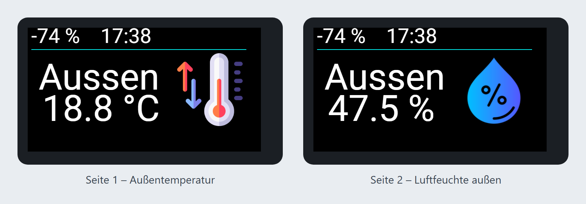
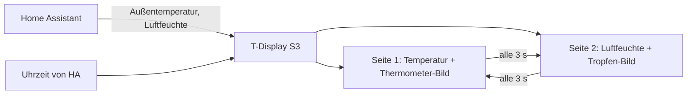

# Test Lilygo 2 – ESPHome

Kleines Farbdisplay für den Schreibtisch oder die Wand: Ein **LILYGO T-Display S3** zeigt im 3-Sekunden-Wechsel die **Außentemperatur** und die **Luftfeuchte außen** aus Home Assistant, darüber WLAN-Signal und Uhrzeit.



> Die Bilder sind Vorschauen, die aus den Koordinaten der YAML mit echten Werten nachgezeichnet sind – keine Fotos vom Gerät.

## Hardware

| Teil | Hinweis |
|---|---|
| **LILYGO T-Display S3** | ESP32-S3 mit 16 MB Flash und Octal-PSRAM, 1,9″-Farbdisplay 320 × 170 (ST7789, parallel angebunden) |
| Tasten | GPIO0 und GPIO14 (auf der Platine) – erscheinen in Home Assistant als „Button 1“ und „Button 2“ |
| Hintergrundbeleuchtung | GPIO38 per PWM – in Home Assistant als dimmbares Licht „Backlight“ |
| Display-Versorgung | GPIO15 wird beim Start eingeschaltet (`lcd_power_on`) |

Es muss nichts verdrahtet werden – nur USB-C zur Stromversorgung.

## So läuft es



## Installation

1. `test-lilygo-2.yaml` und den Ordner `image/` (mit `temperature.png` und `feuchte.png`) in den ESPHome-Ordner kopieren.
2. Die Zeilen aus `secrets.yaml.example` in die eigene `secrets.yaml` übernehmen und eigene Werte eintragen.
3. Feste IP unter `wifi: manual_ip:` anpassen oder den Block entfernen.
4. Die Entitäten (siehe unten) an das eigene Home Assistant anpassen.
5. Beim ersten Mal per USB flashen, danach per OTA. Der Display-Treiber wird beim Kompilieren automatisch von GitHub geladen: [landonr/lilygo-tdisplays3-esphome](https://github.com/landonr/lilygo-tdisplays3-esphome).

## Verwendete Home-Assistant-Entitäten

| Anzeige | Entität |
|---|---|
| Außentemperatur | `sensor.mittelwert_temperatur_aussen` |
| Luftfeuchte außen | `sensor.mittelwert_huminity_aussen` |
| (eingelesen, derzeit nicht angezeigt) | `sensor.shellyplus_temperatur_bwwp_puffer_temperature`, `sensor.victron_battery_soc` |

## Hinweise

- Oben links steht das WLAN-Signal in **dB** (z. B. „-74“). Die YAML schreibt dahinter ein „%“ – das ist nur die Beschriftung, kein Prozentwert.
- Wärmepumpe und Solar-Akku werden schon eingelesen und können für weitere Seiten genutzt werden.

## Dateien

```
test-lilygo-2.yaml     ESPHome-Konfiguration
image/                 Bilder für die Display-Seiten
secrets.yaml.example   Vorlage für secrets.yaml (nicht ins Repo!)
docs/                  Vorschau der Display-Seiten
.gitignore             hält secrets.yaml und den Build-Ordner aus dem Repo
```
